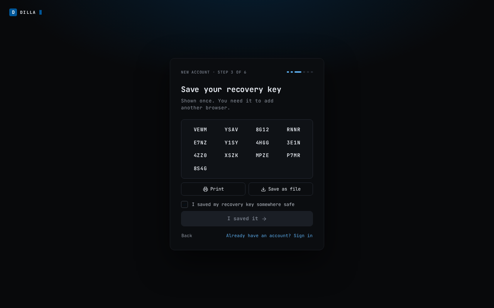
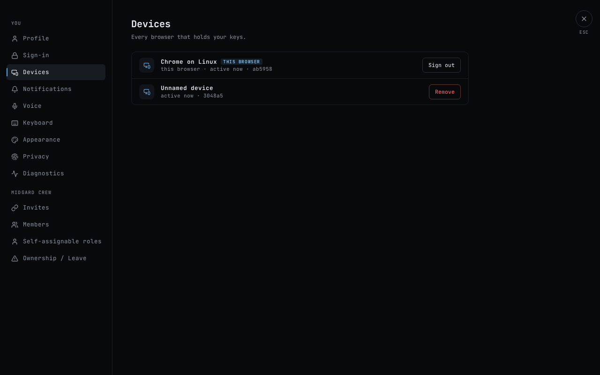
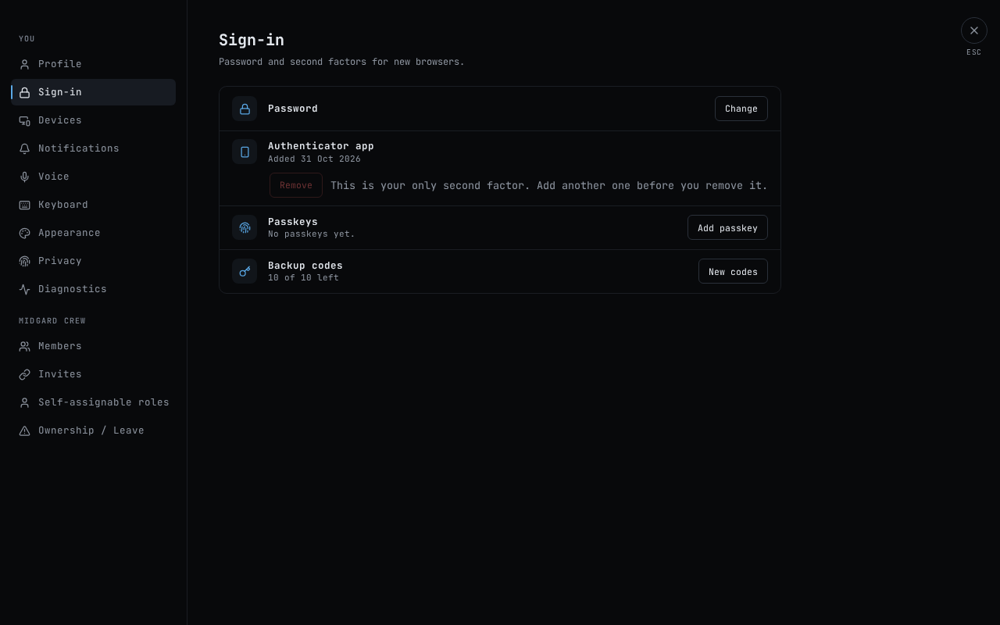
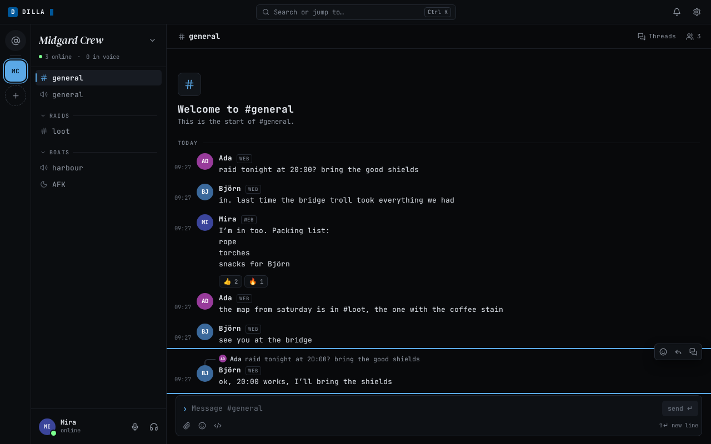
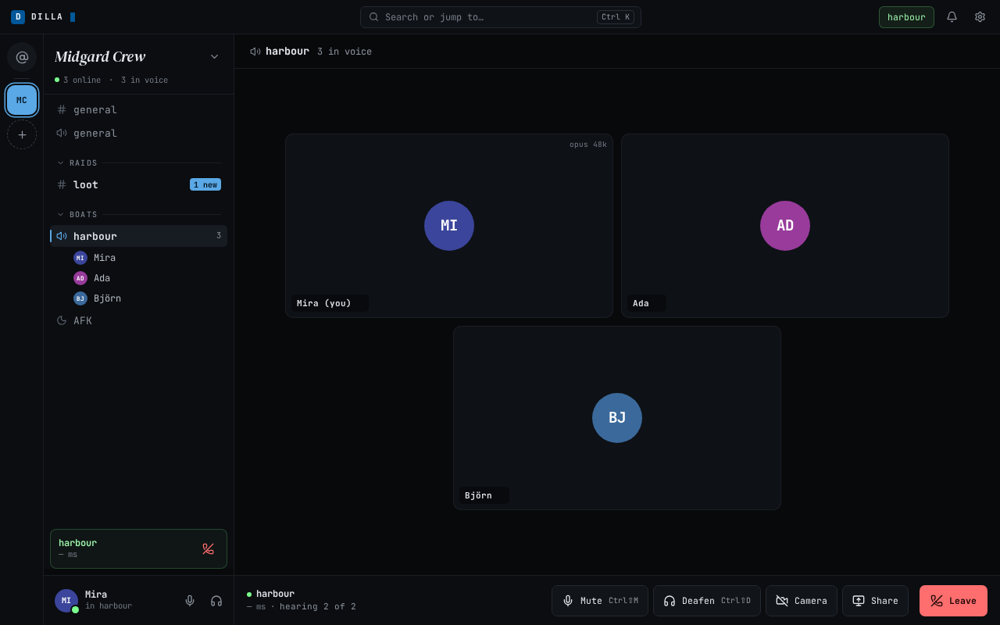
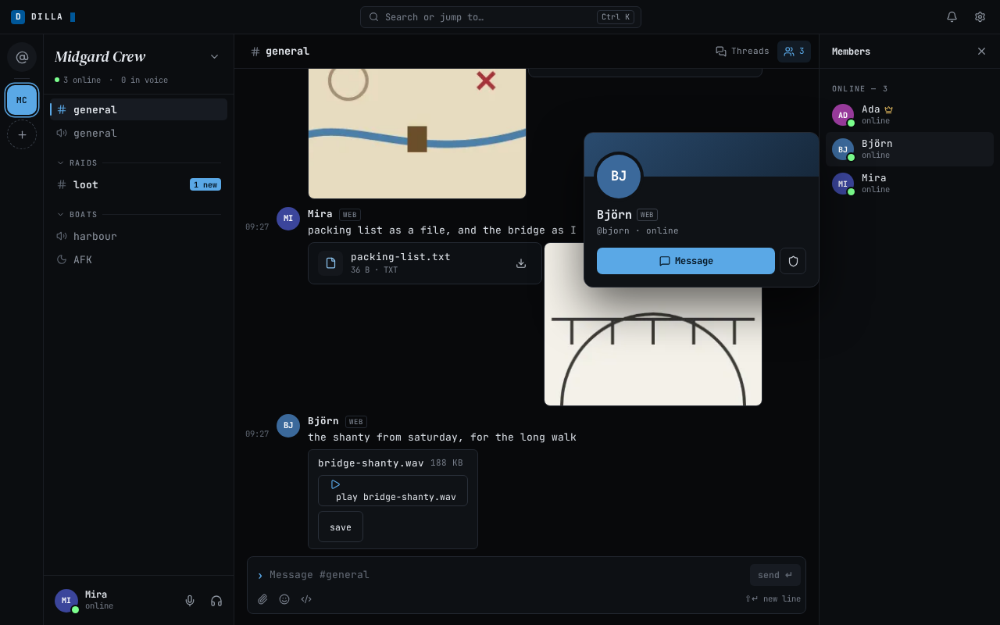
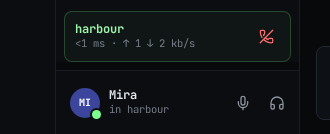
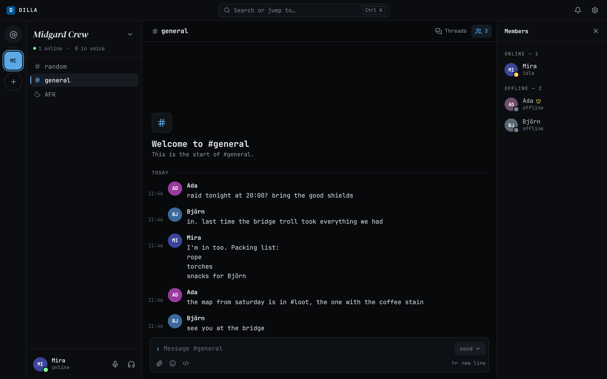

# dilla

> **Not audited. Not for production.** dilla is under construction. Nothing here has had an
> independent security review, and the project makes no end-to-end encryption claim until one is
> published. Run it only to develop it.

dilla is an open-source, self-hosted alternative to Discord, for a group that wants to leave Discord and
host its own place to talk: servers with text channels and drop-in voice, DMs, roles and permissions,
screen share and bots, with end-to-end encryption as the silent default. An instance is one Go binary,
`dillad`, that serves the HTTP API, the WebSocket gateway, the MLS delivery service, the LiveKit media
server, the TURN relay and the download page for the desktop app, on SQLite or Postgres. Anyone who can run one process on a
machine their group can reach can host it.

## What works today

As of the Signal redesign, wave B (unreleased, 2026-10-31), on top of the web3.12 release (2026-10-22).

| Part | State |
|---|---|
| The server, `dillad` | Accounts and devices, servers (communities in the API), text channels, DMs, roles, permissions and channel overwrites, kicks and bans, invites, attachments (blobs), reports, encrypted backup objects; `dillad init`, `serve`, `doctor`, `backup`, `restore` and `admin`; TLS by ACME (TLS-ALPN, DNS or IP) or behind a proxy. Install script (systemd, no Docker), systemd unit and Proxmox helper; no container image: see the [operator guide](docs/deploy/README.md). |
| Encrypted calls, at the protocol and media level | Voice, camera and screen share through the in-process LiveKit SFU and TURN relay, with every media frame encrypted end to end (SFrame keys from MLS), driven by the media package `packages/media`. The desktop app uses it for voice channels and calls. |
| The Signal look (wave A, v0.1.0-signal1) | The app is redrawn on the Signal design (docs/design/signal): a dark, blue-accented theme (`signal`, the default; light and high contrast stay), JetBrains Mono with the server name in DM Serif, and Lucide icons. A top bar holds the wordmark, "Search or jump to…" (Control/⌘+K, also Control+/) with channels, people, settings, actions and messages in one list, the reminders bell (due count, Due and Upcoming tabs) and settings; while you are in a call it shows the room and your ping. The rail is 56 px with the `@` home tile; the channel list (244 px) shows the server name, "3 online · 5 in voice", categories, voice channels with their people (LIVE, camera, muted, playback only) and AFK last; the user panel shows your custom status, or "in harbour" during a call. The channel header has **Threads** and **Members** with the count; pins, edit channel, mute and notifications are in the channel row's menu (right-click, long press or Shift+F10), a DM's call in the DM row's menu. Messages group per person, with reactions, replies, a thread chip ("3 replies · last 20:33"), highlighted code blocks with Copy, and Glenn's "started music" card; the composer has attach, emoji, GIF and a code block button. The voice stage focuses a screen over a filmstrip with each person's ping, has a Grid view, the now-playing bar and a share picker (source, resolution, frame rate, system audio, an upload estimate, Go live). Settings is one full-screen workspace: You (Profile, Sign-in, Devices, Notifications, Voice, Keyboard, plus Appearance, Privacy and Diagnostics) and the server's sections (Overview, Roles with a permission editor, Invites, Bot with its capabilities, Music and more). Phones get Home, Activity and You tabs at the prototype's sizes. Deploy notes are in the [release notes](docs/deploy/releases/v0.1.0-signal1.md). Where the older notes below describe the earlier layout (a 72 px rail, header icons for pins and search, a gear in the user panel, search scopes, a **sound from** list, 44 px phone controls), this row is the current one. |
| Signal wave B (v0.1.0-signal2) | Commands have a grouped list and inline chips; private results show Working, Done, Failed or, for a cancelled kick or ban, Not confirmed. Sign-in supports passkey autofill and six-digit code boxes; signup follows six steps with Save as file for the recovery key and phone backup codes behind Show. New or changed passwords need 12 characters; existing shorter passwords still sign in. Voice adds your own menu and an AFK page with Go AFK and Come back. Polls use the Signal dialog and card, count distinct voters and let only an uncertain answer retry. Threads opens the last or most recently active thread directly, in channels and, from signal3, in direct messages and group direct messages. Upload toasts, attachment cards, code toolbars, phone sheets, settings and status menus use the Signal styling. See the [release notes](docs/deploy/releases/v0.1.0-signal2.md) for server changes and deploy order. |
| Bot v2 (v0.1.0-bot2, unreleased, 2026-11-09) | A command is one sealed request to the Bot and its answer comes straight back on the socket the app already has: the picker's list is on the device, nothing polls, and the Bot's health is a real command sent through the server every minute. The Bot ships with `dillad` and runs as its own sandboxed child process, with no separate service. It joins only the text channels an admin marks as **Bot channels** and posts only there. Incoming webhooks (`POST /hooks/<id>/<secret>`, JSON `{"text": …}`) post into a Bot channel through the Bot. Greyed commands in the picker say why ("Mark a channel as a Bot channel first", "The Bot is offline since 06:24"). The app talks to the server over the WebSocket for everything after sign-in (wire 6): older apps are told "Update dilla to continue". AutoModeration is removed; warnings, timeouts, kicks, bans and the moderation log stay. See the [release notes](docs/deploy/releases/v0.1.0-bot2.md) for the upgrade order. |
| Client changes (v0.1.0-bot2.4, desktop 0.1.0-beta.5) | The call card and Now playing stay visible inside a voice channel, and the animated signal bars are gone. A private Bot reply goes away a minute after it finishes (not while working or offering Retry; hovering or focusing it pauses the countdown). The Bot card has a ⋯ button with Rename, Refresh status and Disable. Message times are always 24-hour (20:27); dates and other times follow the system region. The desktop app shares a screen or window through a thumbnail picker on macOS, Windows and Linux X11 (Wayland keeps the system picker). A device that loses voice to another of your devices says "Voice moved to your other device." and does not rejoin. The poll form stays open when the Bot's command list refreshes. On the server, `bot music playback ended` carries `detail=` and a track that ends normally is not counted as failed, and repeated failed checks for new messages mark the Bot degraded in `dillad doctor`. No schema or wire change. See the [server notes](docs/deploy/releases/v0.1.0-bot2.4.md) and [desktop notes](docs/deploy/releases/desktop-v0.1.0-beta.5.md). |
| Accounts, servers and calls (web3.12, 2026-10-22) | A new instance starts with the bootstrap invite: the first person signs up and starts a server ("new server"), which comes with a text and a voice channel called general. Whoever manages channels adds more, and every member who may invite makes invite links with an expiry and a number of uses (server settings → invites), so a group gets from an empty instance to talking without the HTTP API. Sign-up is six steps with a required second factor (an authenticator app or a passkey, plus backup codes); another device signs in with the password, the second factor and the recovery key, and Settings → Devices lists, renames and removes devices. Roles and private channels, slow mode, announcement channels, threads, the member list with profiles, the AFK channel, polls and a call code are all there. The details are in [Getting started](docs/user/getting-started.md) and [Voice, calls and media files](docs/user/voice.md). |

### The native desktop client (GPUI)

As of desktop alpha.3 (2026-11-25). The Rust/GPUI desktop client in `clients/desktop`. It replaces the Electron
app, which is discontinued at `desktop-v0.1.0-beta.5` (installed copies get no further updates). Alpha releases
(`desktop-gpui-v0.2.0-alpha.N`) carry Linux packages (AppImage, tar.gz, deb, rpm and an AUR recipe; the packages
replace an installed beta.5, [how to install it](docs/user/desktop.md#install-the-linux-alpha)), a signed and
notarized Mac app (Apple silicon) and a Windows installer
([install on macOS and Windows](docs/user/desktop.md#install-on-macos-and-windows)). From the first signed alpha on
it checks for updates itself (an AppImage, the Mac app and the Windows install update in place; a package says a new
version is available).
It draws the Signal design at pixel parity with the Electron app on Linux (macOS and Windows tolerances are still being
measured). What works today, screen by screen:

| Screen | State |
|---|---|
| Shell | The server rail, the channel list with categories you can fold (a Bot channel and a slow-mode channel say so on their row), the user panel (click your name for your status: online, idle, do not disturb, invisible; do not disturb holds the notifications; mute and deafen beside it), the channel header and the members aside, with a splitter between panes (widths and folded categories are kept per instance). Back and forward through the places you have been (Alt+Left, Alt+Right), the previous and next channel (Alt+Up, Alt+Down), Control/⌘+, for your settings. The boot screen, "dilla could not start" with a Try again action, a device the instance no longer accepts or whose stored key is gone explained, with Forget or Reset after a confirmation, and the offline and "this instance needs a newer app" banners. |
| Messages | Markdown and code blocks, mentions with a list as you type, edit (Up in an empty composer edits your newest message) and delete of your own messages, pin and unpin, a draft kept per channel, a failed send with its reason and retry or discard, the typing signal, slow-mode and announcement-channel notices, the timed-out notice, Page Up and Page Down in the log. A member allowed to manage messages removes someone else's message for everyone, with a reason. Load earlier in channels and direct messages. Author names take their role colour, and the app animates as the Electron app did (honouring Appearance → Motion and the system's reduced-motion setting); toasts show. |
| Threads | The reply line, the reply bar, the thread pane with its own composer, the reply count on the root (Escape closes the pane). Slash commands and polls work in threads; a long thread has Load earlier (desktop only). |
| Reactions | The reaction bar, the emoji grid from the composer and from the message toolbar, and who reacted. |
| Attachments | The tray, file cards, the image grid, the lightbox, drag and drop, the GIF picker and saving a file. Audio plays inline (MP3, AAC, Vorbis, Opus, FLAC, WAV); so does video (WebM and MP4 with VP8, VP9, AV1, and H.264 except on macOS), with play, pause, seek, volume, full screen and the ⋮ menu (download, playback speed, picture in picture); a video it cannot decode opens in the system player. |
| Direct messages and trust | The Home list of DMs, the DM picker, DM conversations, trust alerts when a contact's identity changes, the safety-number comparison, and Settings → Privacy. Unread dots on direct messages; names sort by your system's language. |
| Members, roles and moderation | The members aside, the profile card and the person menu (message, mention, profile, edit roles, copy username, compare safety numbers, kick, ban) as your permissions allow, the moderation dialogs, and the Roles, Self roles, Members, Bans and Moderation log sections of the server settings. |
| Server settings | Overview (name and AFK timeout, saved together; a dirty-draft guard on leaving; a section whose permission you lose falls back to one you still have), Channels, GIFs, Invites, Welcome, Join roles and Danger zone, only the sections your permissions allow. Welcome messages (channel and text, with Reload), ban details, and check boxes the size of the Electron app's. |
| User settings | Profile, Devices (rename, remove a device with the recovery key, sign out), Appearance, Keyboard (the shortcut table), Privacy, Sign-in (password, authenticator app, passkeys, backup codes, each behind "Confirm it is you"), Notifications, Voice and Diagnostics. The bio field resizes. |
| Voice, rings and AFK | Join and leave voice channels, the people under a channel, the dock, the stage with a tile per person (a person's camera or screen share is drawn when they send one; a focused tile has Grid and full screen), the person menu on a tile (right-click or Shift+F10: a person's or a stream's volume, applied to what you hear, Mute for me, profile, message, copy username; your own: mute, deafen, Move to another voice channel, leave), your own camera (Linux, Windows, macOS) and screen or window share from a picker with thumbnails (the system's dialog on Wayland and macOS), the stream quality applied live, and one application's sound with the share (Linux, Windows 10 2004 or newer, macOS 14.2 or newer), the call controls with the ping and ↑ ↓ kb/s, mute and deafen (Ctrl+Shift+M, Ctrl+Shift+D), push to talk while the window has focus (with the PTT tag on the mute button; AltGr with the key is refused on Linux too), Return to call in Settings, joining with no speaker or microphone (listening, as the Electron app did), DM calls with the incoming-ring banner (Enter answers, Escape declines), blocked calls and the comparison they offer, and the AFK channel's page and move notice. Calls are end-to-end encrypted. The dock shows the link quality, and a shared window brings its application's sound. |
| Voice settings | Input and output devices and volumes, the microphone test with its sensitivity meter, the input mode and the push-to-talk key (F13 to F24, Pause, Scroll Lock, Insert), noise suppression, echo cancellation, automatic gain, and the join, leave and ring sounds. |
| Bot | The `/` command picker with named fields and greyed commands, private results, poll cards, reminders; in the server settings, the Bot page (its card with Restart and a menu to rename, refresh or disable the Bot, capabilities, health, Bot channels, webhooks, each change behind "Confirm it is you") and the Music page (which roles may DJ), with the Now playing row in the dock. Every built-in command runs, in channels and threads (an uncertain one reopens its draft); the poll form, scheduled announcements and role panels (`/rolepanel create`) open from the message box; the Bot's "started music" message has a now-playing card and the voice stage a now-playing bar. A channel row's menu sets its notify mode and has Edit channel. |
| Notifications | The settings rows: the mode for the selected server and its @everyone switch, desktop notifications on this device, and one switch for the join, leave and ring sounds. Messages, mentions and rings raise operating-system notifications (a ring with Answer and Decline); a click opens the conversation. Rings and messages notify from the tray with every window closed, and after a start at login. On Linux an ended ring's notification is withdrawn and a newer message in a conversation replaces the earlier one. |
| Search | The palette (Control/⌘+K or Ctrl+/) with Channels, People, Settings, Messages and Actions. Messages are found in this device's own decrypted history; the query never leaves the device. A result older than what is shown jumps to it. |
| Diagnostics | Settings → Diagnostics: the connection, the slowest requests and the last 20 error codes, with Copy codes (codes only, nothing of your content). A log file for bug reports ([where it is](docs/user/desktop.md#logs); no content, keys or tokens). |
| Onboarding | Sign-up with an invite (the account, the recovery key shown once), the second factor set-up, the done step, sign-in on a new device with the recovery key, a passkey or the instance's identity provider (in the system app), create server, create channel (private from birth with the roles that may see it, or an announcement channel with the roles that may post), join by invite and the invite link. |
| Second factor | Required for every account: the forced-factor screen, set-up of an authenticator app or a passkey, backup codes, and the step-up dialog. |
| Several instances | One window and one client per instance, and the "Dilla - your instances" window to connect by address, join by invite, open or remove an instance (up to 32). |
| Tray and background | The tray icon with your open instances, "Start Dilla at login" and "Quit Dilla"; closing the last window keeps Dilla running in the tray; the unread count in the tray's tooltip, the macOS dock and the Linux launcher; start at login opens no window. On macOS, the Dilla, Edit, View and Window menus. |

## What is not there yet

As of 2026-11-09, for the Bot:

- Automoderation. Bot v2 removed it, and its stored settings were deleted on upgrade. Manual moderation (warn,
  timeout, kick, ban, the moderation log) is unchanged.
- Outgoing integrations: a command that calls an admin's URL (for example `/weather`). Incoming webhooks exist.
- Marking Bot channels for you. After the upgrade no channel is a Bot channel until an admin marks it, and the
  features that post (welcome messages, announcements, role panels, polls, the music card) wait for one.
- Music from anywhere but YouTube.
- Compatibility with older apps. Wire 6 refuses them all.

As of 2026-10-22, in the client:

- Server-checked permissions: who may send is checked only by members' apps in this version, and so are pins and
  @everyone. The role view is not verified by the group: a bad host could hide pins and @everyone or show members
  different role views, though it cannot read or change messages. Six permissions (manage messages, view audit log,
  bypass slow mode, mute members, move members, manage nicknames) have no effect yet.
- People who gain a channel see only messages sent after they join it.
- Enhanced noise suppression comparable to Krisp. DeepFilterNet3 is an unqualified local experiment; see [evaluation findings](experiments/noise/results/FINDINGS.md).
- Native iPhone and Android apps (planned, no date yet) and push notifications on phones. The recovery key adds another device
  or phone with the account password; it does not restore messages sent before that device joined.
- A dedicated operator command that resets an account's recovery data, which the recovery-data warning asks for.
  (`dillad admin user reset-factors` resets a person's second factor, not their recovery data; `dillad admin device
  revoke --all` signs every device of a person out, for a person who lost them all, and does not touch the recovery data.)
- Avatars (a profile has a display name, a status message and a bio that you edit in Settings → Profile, but no picture).
  The bio, the status message and device names are stored readable by the server, not end-to-end encrypted.
- Showing an invite link again after it was made: by design, an invite link is visible once, when it is made, because the
  server keeps only a fingerprint. Revoke the link and make a new one.
- Voice on a phone: there is no phone app yet.
- On Windows, a shared screen or window may send the call's own sound back (an echo) on some setups; share a window that is not playing the call.
- Ringing while dilla is closed, and answering from the notification itself.
- Link previews and custom emoji; files over 25 MB.
- Notifications stop when the app is closed.
- Comparing safety numbers with someone you share no conversation with ("Open a conversation with
  this person to compare numbers."), and scanning the QR code (it is shown for reading only). Privacy shows no date for a verification, and a verification made on one device
  does not carry over to your other devices. Privacy's note that a changed
  contact left a conversation is lost after a reload (the contact still shows as changed), and the changed-identity
  alert in a conversation opens Privacy, where you pick **Compare with …**, rather than the comparison itself.
- Settings that follow you to your other devices (each device keeps its own), and server-readable channels.
- Changing your own identity key keeps the other devices working only if they sign in again: a device left on the
  old key shows the "different identity" warning and must be enrolled again.
- More than one running copy of the app per device: a second copy waits and shows nothing of the conversation until you move
  the app to it.

For the native desktop preview:

- The macOS and Windows packages (DMG, Windows installer): build it from source there. Linux has
  alpha packages (AppImage, tar.gz, deb, rpm, AUR recipe), installed by hand. Clicking a `dilla://invite` link opens it in the
  app: the deb, rpm and Arch packages register the `dilla:` scheme, as do the macOS and Windows packages (an AppImage
  only through an integration tool such as AppImageLauncher; the tar.gz does not).
- Push to talk while another window has focus (system-wide push to talk). Screen readers are supported (AccessKit).

The native [desktop client](docs/user/desktop.md) has Linux alpha releases and is built from
source on macOS and Windows; the Electron app is discontinued at `desktop-v0.1.0-beta.5`. Native iPhone and Android apps are planned, with no date yet. There is no
published security review or published capacity report yet.

## Run it

The [operator guide](docs/deploy/README.md) covers the install script (`deploy/install.sh`, a native systemd install and the one supported way to run dillad, attached to every release), the systemd units and the Proxmox
helper, the TLS modes, the TURN relay and LiveKit settings, backup and restore, and operating the required
second factor (resetting a person's factors, passkey settings behind a proxy).

## Use it

[Getting started](docs/user/getting-started.md) is for the first person on a new instance (starting a server,
inviting people, adding channels) and for a person with an invite: the sign-up, what the
app keeps, the app and its keyboard, slow mode, announcement channels and threads, saying more (edits, reactions, replies,
pins, mentions, images and files), comparing safety numbers, search, settings, typing and a second copy of the app, and the
known limits. [Voice, calls and media files](docs/user/voice.md) covers voice channels, the stage, DM calls and ringing,
camera and screen share, push to talk, the call code, AFK channels, sounds, and audio and video files.
[Bot commands](docs/user/bot-commands.md) explains the command picker, named fields, private results, Bot channels, greyed commands, webhooks, polls, and reminders. [Music](docs/user/music.md) covers setup and playback. Server settings (Signal): **roles** edits a role in place beside the role list, and who may DJ is its **Control music (DJ)** permission, checked per voice channel (roles the bot had approved as DJs keep it after the upgrade); **invites** can make links that never expire or have no use limit, for people who may manage the server; **bot** has a switch for each part of the bot, including Polls and Reminders (off stops only making new ones), and the bot's card with its version and **Restart**; **music** sets the default volume and how long the bot stays in voice with nothing playing.

## Repository layout

| Path | What |
|---|---|
| `protocol/` | Normative protocol documents and conformance test vectors (Apache-2.0) |
| `packages/protocol-vectors` | TypeScript reference implementation that generates the vectors (Apache-2.0) |
| `clients/desktop` | The native Rust/GPUI desktop client (Linux alpha releases; built from source on macOS and Windows) |
| `docs/superpowers/specs` | Product and system design specifications |
| `docs/superpowers/plans` | Implementation plans |
| `docs/design` | Design brief, and the Signal design reference in `docs/design/signal` (the current design) |
| `docs/deploy` | The operator guide |
| `docs/user` | The user guide and its screenshots |

## Licence

Server and clients: AGPL-3.0-or-later (`LICENSE`). Protocol documents, test vectors and SDK
libraries: Apache-2.0 (`LICENSE-APACHE`). Contributions are accepted under the Developer
Certificate of Origin (`DCO`): sign off every commit with `git commit -s`.
