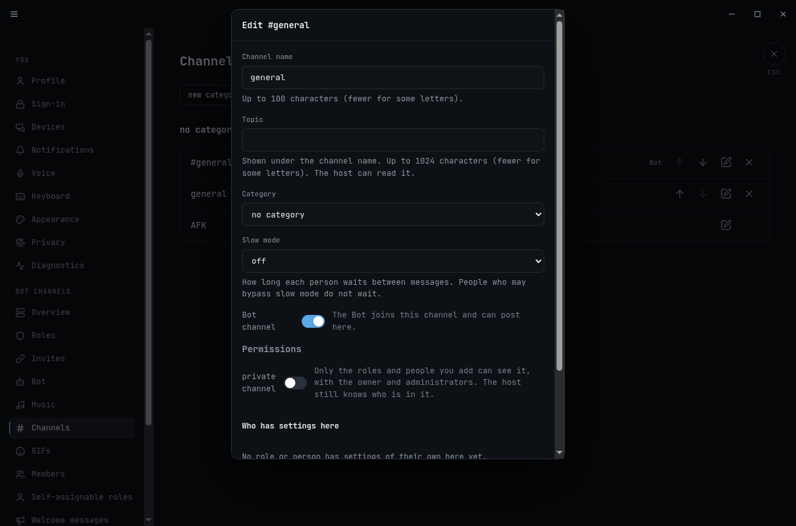
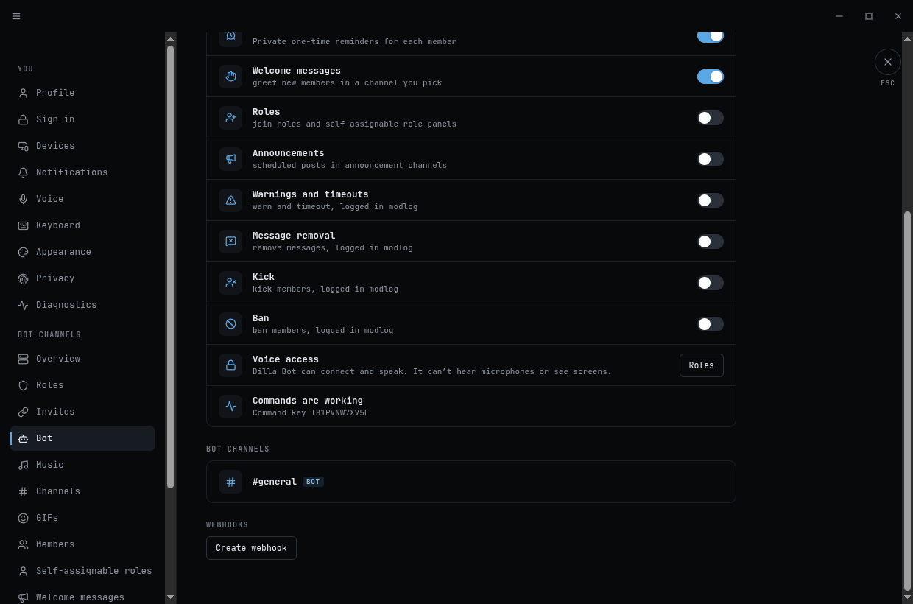
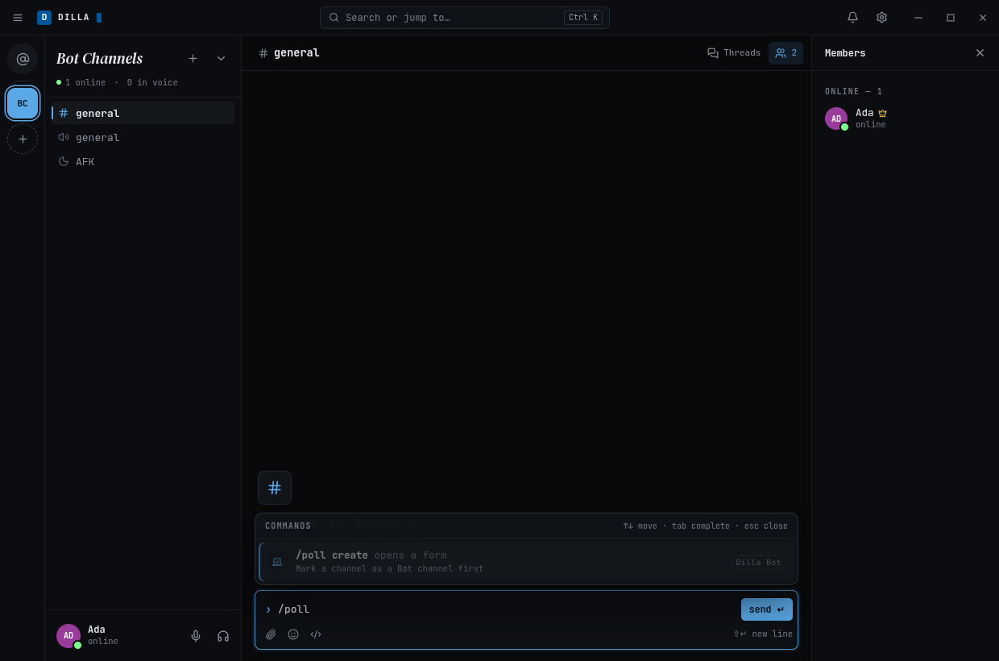
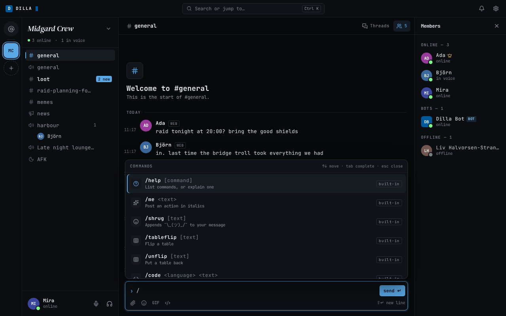
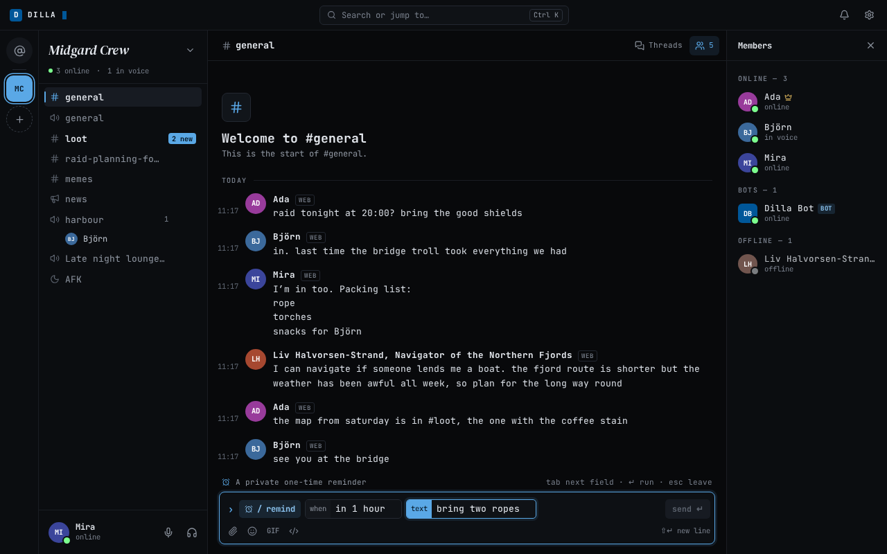
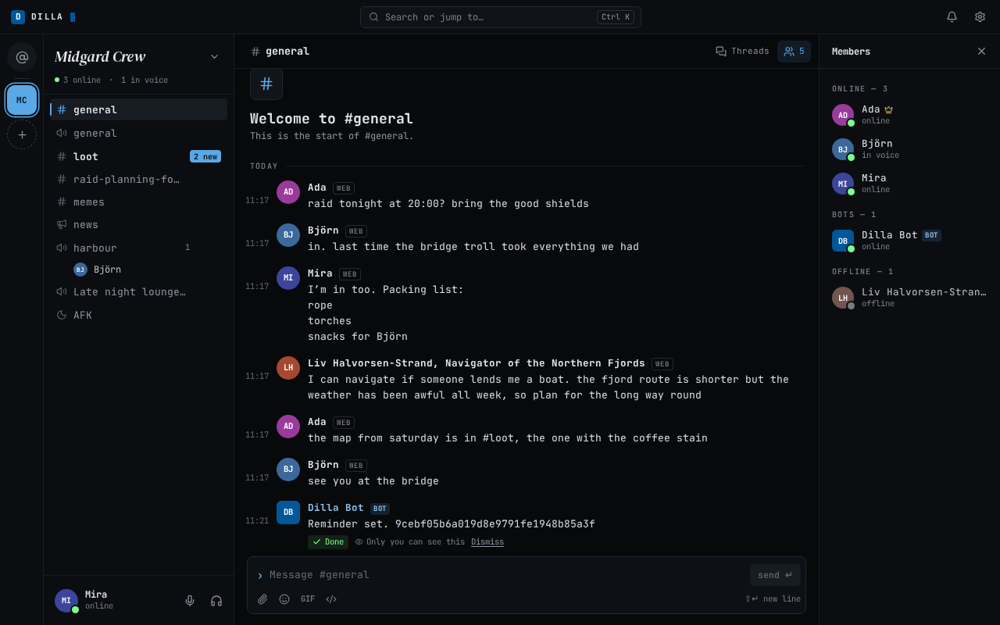
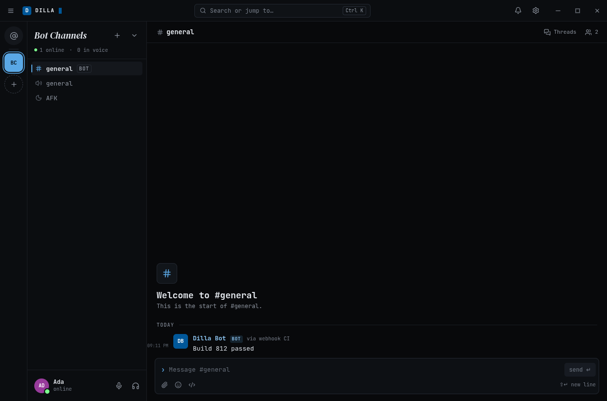
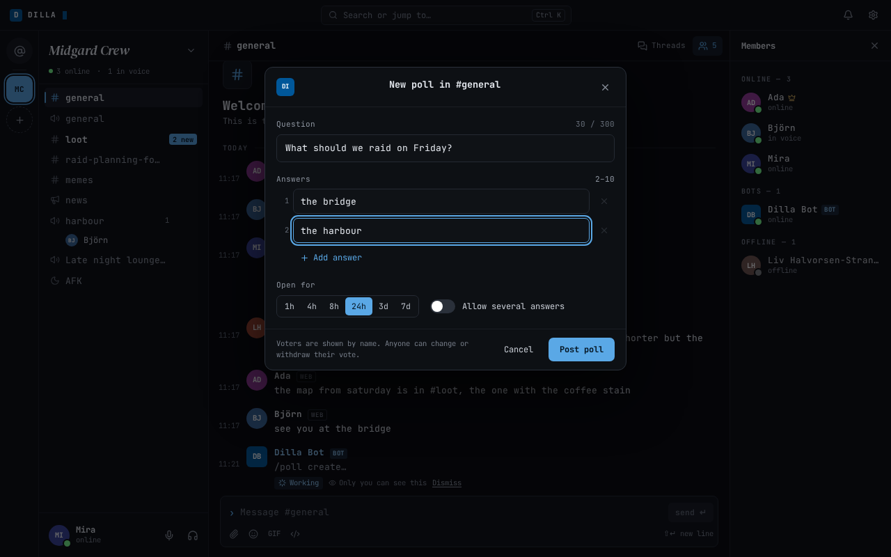
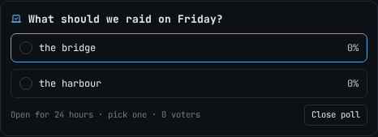

# Bot commands

Use the command composer to run a built-in or managed bot action. In a community
channel, type `/` at the start of the message box to open the command picker. Pick
an entry, then fill its inline chips. The list groups commands as Built-in and Bot,
with an icon and description for every available command. Required fields and permissions are checked
before you send. Start typing to filter entries; use Up/Down to move, Enter or Tab
to select, and Escape to close the list or leave command mode while keeping your
draft. You can also type a complete command and its named arguments. Normal
mentions, multiline text, IME input, and attachments keep their usual behavior.

Command drafts stay separate from text drafts for each conversation and thread.
A command does not take an unrelated reply or attachment with it. Unknown slash
input stays private. Choose **Send as text**, or prefix the text with `//`, to post
a slash literally. Ordinary messages, edits, history replay, and bot-authored
messages never run commands.

Results are private to you unless a command explicitly publishes something. A
private card shows **Working**, **Done** or **Failed**. Bot results use the bot’s
name (Glenn by default) and BOT tag; built-in results use **dilla** and the D tile.
A private reply, the ones marked "Only you can see this", goes away by itself a minute after it
finishes. A reply that is still **Working**, or that offers **Retry**, stays. Pointing at a reply, or moving focus onto
it, pauses the countdown, and it carries on when you leave. **Dismiss** removes a reply at once.
An uncertain result uses **Failed** with text explaining what may have happened. An
upload receipt alone does not mean the requested action completed. Commands run
through the built-in or managed bot and obey current community, channel, and role
permissions. Inaccessible users, roles, and channels are not suggested.

Commands go to the Bot in one step and the answer comes straight back. The list of commands is already on your
device when you type `/`, so the picker never waits for the server.

If Bot commands are missing on a device after a server update, quit and relaunch the app, or reload the browser tab.
A resume is not enough.

## Bot channels

The Bot joins only the text channels an admin marks as **Bot channels**. It posts only there. A Bot channel
shows a **Bot** tag in the channel list, and the Bot is in its member list.

To mark one, open **Server settings → Channels**, choose **edit** on a text channel and turn on **Bot channel**.
It takes effect at once. You need the permission to manage the server. **Server settings → Bot** lists every Bot
channel. Turning the switch off removes the Bot from that channel.

Commands work in any channel or direct message. What needs a Bot channel is anything the Bot posts: welcome
messages, scheduled announcements, role panels, polls, the "Music started" card and webhook posts. Pick the Bot
channel for each of these in its settings. Nothing is marked for you, so after the update those features keep their
settings and post nothing until you pick one. The Bot page marks them "Needs a Bot channel". Posts the Bot made
earlier stay where they are. A poll in a channel that is not a Bot channel stays readable but takes no more votes.





If the Bot page says **The Bot needs adding to this channel again**, press **Add the Bot again**. This can happen when
marking a channel and a Bot restart land at the same moment. It takes a minute at most.

## Greyed commands

A command that cannot run now stays in the picker, greyed, with the reason under it. It does not disappear.

- **Mark a channel as a Bot channel first.** The command posts into a Bot channel and the server has none you
  can see. Ask an admin to mark one.
- **The Bot is offline since 06:24.** The Bot is not running. The time is when it was last seen.
- **The Bot is having trouble since 06:24.** The Bot is running but not answering in time. **Server settings →
  Bot** says "Commands failing since" with the same time.
- **The Bot is turned off in this server**, or **This server has no Bot.**



If you send a command and nothing comes back within 5 seconds, the card says "The Bot didn't answer" and offers
**Retry**. Retry sends the same command again and never runs it twice.

## Available commands

Fields in angle brackets are required; square brackets are optional. In the
composer they appear as named chips with suggestions where available. Move
between chips with Tab or Shift+Tab. Errors appear in the command bar and mark
the active chip. Escape leaves command mode and keeps your text.

| Area | Commands |
| --- | --- |
| Help and text | `help [command]`, `me <text>`, `shrug [text]`, `tableflip [text]`, `unflip [text]`, `code <language> <text>` |
| Search and conversation | `giphy [query]`, `dm <user>`, `invite`, `search <query> [scope]`, `topic <text>`, `thread <message>`, `reply <message> <text>`, `edit <message> <text>`, `delete <message> [reason]`, `pin <message>`, `unpin <message>` |
| Voice and music | `join <voice-channel>`, `leave`, `mute`, `unmute`, `deafen`, `undeafen`, `play <query-or-url>`, `pause`, `resume`, `skip`, `stop`, `queue`, `nowplaying`, `seek <position>`, `volume <0..100>`, `shuffle <on|off>`, `repeat <off|one|all>`, `queue remove <item>`, `queue move <item> <position>`, `queue clear`, `music` |
| Moderation | `kick <user>`, `ban <user> [duration] [reason]`, `unban <user>`, `timeout <user> <duration>`, `untimeout <user>`, `warn <user> <reason>`, `modlog`, `role add <user> <role>`, `role remove <user> <role>`, `selfrole list`, `selfrole add <role>`, `selfrole remove <role>`, `rolepanel create` |
| Announcements | `announcement list`, `announcement create`, `announcement edit`, `announcement delete` |
| Polls and reminders | `poll create`, `poll vote`, `poll results`, `poll close`, `remind <when> <text>`, `reminders list`, `reminders cancel`, `reminders dismiss` |







**/kick** and **/ban** ask you to confirm, with the person’s avatar and a Logged row.
Ban also shows Duration and Reason; Kick has neither. **Cancel** adds a private
**Not confirmed** row only for Kick and Ban. Closing another command’s dialog
abandons it without that row. A permanent ban has no end date.

Some commands open a dialog for actions with more choices. Voice/music
commands target the voice channel you joined. Music playback selects the first
search result or plays a supplied URL or playlist. Owners and administrators can
control playback; anyone else needs the **Control music (DJ)** role permission and
**View channels** in that voice channel. The bot needs access
to connect and speak in the voice channel. See [Music](music.md) for setup and
playback details.

## Turning commands off

**Server settings → Bot** has a switch for each part of the bot: Music, Polls,
Reminders, Welcome messages, Roles, Announcements, Warnings and timeouts, Message
removal, Kick and Ban. Turning one off removes its commands from the picker. For
Polls and Reminders only making new ones stops: polls already posted can still be
voted on and closed, and reminders already set are still delivered and can be
listed, cancelled and dismissed. Saving a change asks for your password or second
factor.

The same page shows the bot's card ("Managed bot · online · v0.4.2"; the version
shows once the bot reports it). **Restart** asks the bot to restart; it does so the
next time it checks in with the server, and the page says "Restarting…" until it
has. Pending results recover on their own. The card's menu (right-click, a long
press or Shift+F10) has **Rename**, **Refresh status** and **Disable**. The **⋯** button at the end of the card opens
the same menu, so it is reachable without a right-click. Someone who may not manage the Bot sees only **Refresh status**.

## Webhooks

A webhook lets anything that can send an HTTPS request post into one Bot channel: a game server, a weather feed,
a script. The post appears in the channel under the name you choose, with the label "via webhook" and that name.

On **Server settings → Bot**, under **Webhooks**, choose **Create webhook**, give it a name and a Bot channel. The
address is shown once, so copy it then. It looks like `https://dilla.example.org/hooks/<id>/<secret>`. The secret in
it is the only thing that lets someone post, so treat the address like a password. **Rotate address** gives a new
one and the old one stops at once. **Delete webhook** removes it. A server can have 50 webhooks.

Post with a JSON body. Only `text` is needed:

```sh
curl -X POST 'https://dilla.example.org/hooks/<id>/<secret>' \
  -H 'Content-Type: application/json' \
  -d '{"text": "Build 812 passed", "username": "CI"}'
```

`text` is up to 4000 bytes. `username` (up to 80 bytes) replaces the webhook's name on that post. `avatar_url` (an
`https` address) shows a picture beside it. The server fetches that picture itself, so no member's device ever
loads it. Discord's `content` field is read when `text` is missing, so many existing integrations work unchanged.
Other fields are ignored.

A post is plain text with links. It cannot run a command, and it does not ping anyone: mentions of people and roles
are made harmless. `@everyone` and `@here` work only if you turned on **Allow @everyone** for that webhook.



A successful post answers `204` with no body. The other answers:

| answer | meaning |
| --- | --- |
| `401` | The address or secret is wrong, or the webhook was rotated or deleted. |
| `409` | The channel is no longer a Bot channel. Mark it again. |
| `413` | The body or the text is too long. |
| `429` | Too many posts. Wait the number of seconds in `Retry-After`. A webhook takes 30 posts a minute, with a burst of 5. |
| `503` | The Bot did not take it. Try again after 5 seconds. A channel you just marked answers this for a few seconds, until the Bot has joined it. |

A `503` can come after the Bot already posted, if its reply was lost, so a sender that retries may post twice.

If the server sits behind a reverse proxy, its owner should keep `/hooks/` addresses out of the proxy's access log.
Anyone who can read the log could post to the channel.

## Update dilla to continue

This version changed how the app talks to the server, and older apps cannot connect to it. The desktop app shows
**Update dilla to continue** with an **Update** button. Press it and the app downloads the new version and restarts.
If no update is ready yet, it says so; try again in a little while. A browser tab reloads on its own the first
time.

## Polls

Create polls in Bot channels and their threads. A poll has 2–10
answers, a question of up to 300 Unicode code points, and answers up to 100
code points. The counter matches the server: 🔥 counts as one code point, while a combined
emoji can contain several. Open **/poll create**, type the question and answers, then press **Post poll**.
Use **Add answer** to add answers and the remove control beside an answer to
remove it.

The form stays open when the Bot's command list refreshes in the background. If the Bot really stops offering polls
while the form is open, the form closes and a private reply says "The Bot stopped offering polls. Try again."



Voting is single-choice by default; the creator can enable multiple
choices. The poll shows named voters. Members can replace or withdraw their vote.



The poll message names its author. The card shows time left, answer bars, your choices and a voter count.
For multiple choices it counts distinct people across answers. A bounded read
may show **{n}+ voters**: at least that many people voted. If a vote is uncertain,
“Your vote may not have counted. Tap it again to retry.” appears. Retry only the
answer you tapped; the other answers wait until it settles.

Choose a duration of 1, 4, 8, or 24 hours, or 3 or 7 days; the default is 24 hours.
A community can have at most 128 open polls. The creator or a member with Manage
Messages can close a poll. Closed polls stay readable. Poll records and votes are
kept by the bot, which is the only place that counts them. The bot publishes one poll
card, with a readable fallback when cards are unavailable.

## Reminders

Reminders are one-time and private to your account across your devices. Choose a
duration or a local date and time; the composer previews the exact time in your browser’s time zone.
Durations must be between 1 minute and 365 days. Times in a daylight-saving gap
are rejected; an ambiguous local time asks you to choose which occurrence you mean.

You can have up to 100 outstanding reminders per community. Due reminders remain
in your inbox until dismissed. The inbox supports upcoming and due lists, cancel,
and dismiss. Reminders are saved before success is shown and catch up after bot
downtime or browser closure. Membership revocation or a disabled bot stops access
and delivery. Browser notifications need the existing notification permission and
are not promised while the browser is closed. Reconnecting and unlocking syncs the
private inbox; notification polling is bounded and staggered across devices.
