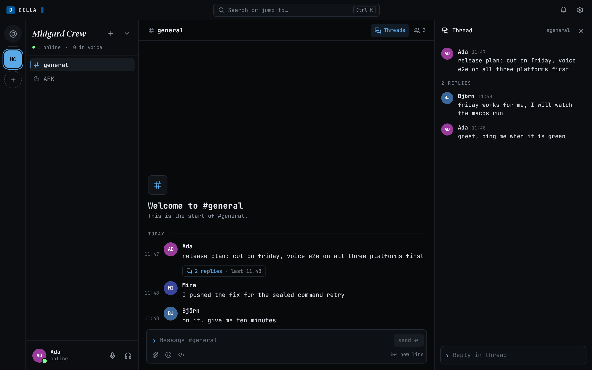
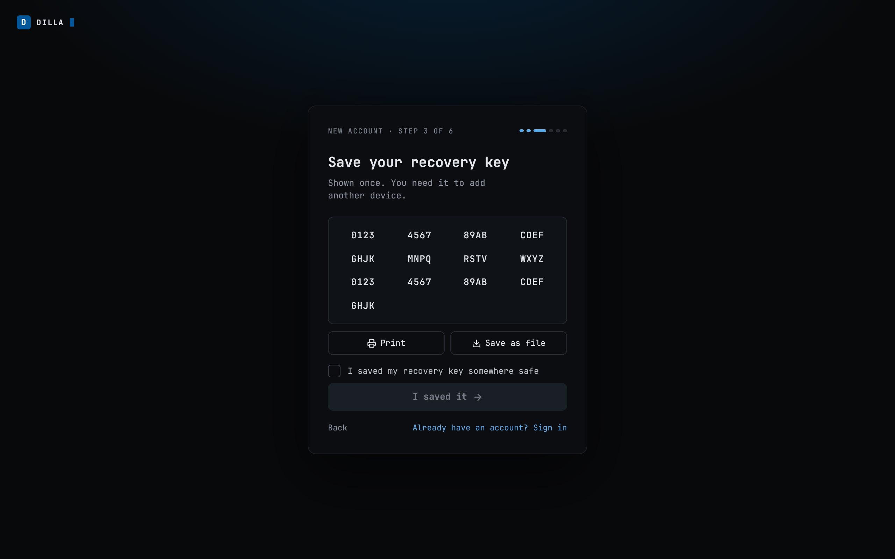

# Dilla desktop

The desktop client is the native Rust/GPUI program in `clients/desktop`. On Linux it is released as an **alpha**
(`desktop-gpui-v0.2.0-alpha.N`): an AppImage, a tar.gz, a deb, an rpm and an AUR recipe, [installed by
hand](#install-the-linux-alpha). It does not update itself yet. On macOS and Windows it is built from source. Keep
using the browser client or the [mobile app](mobile.md) for everyday use.

**The Electron desktop app is discontinued.** Its last release is `desktop-v0.1.0-beta.5`. A copy you already
installed keeps working against a compatible server, but it gets no further updates and no fixes. The browser
web client is deprecated as well.

The desktop app needs a server at v0.1.0-signal1.5 or later. Passkey and identity-provider sign-in go through the
server's `/desktop-auth` routes; an older instance cannot take them, and the app says the instance needs an update.

## The native client (GPUI)

The native client is written in Rust with the GPUI toolkit (`clients/desktop`) and draws the Signal screens at pixel
parity with the web client on Linux. On Linux you install an alpha release; on macOS and Windows you build it from
source. It has no updater and no tray yet. The list of what works, screen by screen, is in the
[README](../../README.md#the-native-desktop-client-gpui).


### A tour

These are frames of the client itself (Linux, 1280 by 800 at twice the scale), shot from the app's test fixtures.






### Install the Linux alpha

Download the files from the newest
[`desktop-gpui-v…` release](https://github.com/dilla-chat/dilla/releases?q=desktop-gpui&expanded=true) (the release
notes carry the same table). `<v>` is the release's version, for example `0.2.0-alpha.1`.

| System | File | Install |
|---|---|---|
| Ubuntu 24.04 or newer, Debian 13 | `dilla-<v>-linux-x64.deb` | `sudo apt install ./dilla-<v>-linux-x64.deb` |
| Fedora 40 or newer | `dilla-<v>-linux-x64.rpm` | `sudo dnf install ./dilla-<v>-linux-x64.rpm` |
| Arch | `dilla-<v>-linux-x64.aur.tar.gz` | Unpack it into an empty folder, read the `PKGBUILD`, then `makepkg -si` there |
| Any distribution | `dilla-<v>-linux-x64.AppImage` | `chmod +x dilla-<v>-linux-x64.AppImage`, then run it |
| Any distribution | `dilla-<v>-linux-x64.tar.gz` | Unpack it and run `dilla-<v>/dilla-desktop` |

The deb, rpm and Arch packages put the app in `/opt/Dilla`, start it as `dilla-desktop` and add "Dilla" to the
application menu. The Arch recipe (package `dilla-bin`) is a release file only: it is not on the AUR. It builds from
the release's own tar.gz, pinned by its checksum.

To check a download, keep `SHA256SUMS` beside the files and run `sha256sum --check --ignore-missing SHA256SUMS`;
`gh attestation verify <file> --repo dilla-chat/dilla` shows that GitHub Actions built it from this repository.

**What it needs.** glibc 2.39 or newer (Ubuntu 24.04, Debian 13, Fedora 40, Arch and newer); Vulkan or OpenGL ES 3
graphics; PipeWire or PulseAudio for calls; and a running **Secret Service**: GNOME Keyring, KWallet or KeePassXC.
Dilla keeps its database key there, so without one it cannot sign in. GNOME and KDE Plasma run one already; on other
desktops install and start one of them first. File dialogs and printing go through the XDG desktop portal, and colour
emoji need the Noto Color Emoji font.

**Upgrading from Dilla beta (the Electron app).** The deb, rpm and Arch packages are named like beta's (`dilla`; the
Arch recipe provides and conflicts with `dilla`), so installing one replaces an installed beta.5 in place. Beta's
files in `/opt/Dilla` are removed (an rpm upgrade can leave its empty folders behind). Beta's app data stays on disk
but is not used, and nothing deletes it. The native app is a **new device** on your account (see below), so keep
another signed-in device and your recovery key at hand. `dilla://` invite links stop opening the app until the native
app handles them; join with the address and the invite code instead. An AppImage or tar.gz runs beside an installed
beta.

### Build and run it

You need the pinned Rust toolchain (`rust-toolchain.toml`) and, on Linux, clang 21 or newer and the X11 and Wayland
development packages (the list is in `.github/workflows/desktop-gpui.yml`). From the repository root:

```sh
# Linux
CC=clang-21 CXX=clang++-21 cargo run -p dilla-desktop
# macOS: nothing extra
cargo run -p dilla-desktop
# Windows (PowerShell): libwebrtc uses the static MSVC runtime
$env:RUSTFLAGS="-C target-feature=+crt-static"; cargo run -p dilla-desktop
```

The first window is "Dilla - your instances". Type the instance's address (HTTPS) to connect, or paste an invite to
join, then sign in or sign up. Each instance gets its own window; `--instance=<n>` opens only instance `n` (a second
copy of the app on another instance, beside the first), and a debug build accepts `--allow-loopback` for an
`http://localhost` test instance. Per-OS build notes are in `clients/desktop/README.md`.

The client keeps its data apart from the browser and from any installed Electron app. Like them, it is a **new device** on your
account: sign in, complete your second factor, then enrol it with your saved 52-character recovery key. Messages sent
before it joined are not shown on it. Keep another signed-in device and the recovery key at hand.

### How it works

- It is one native program: no embedded browser, no web worker, no bundled web client. The store, the keys (in the
  operating system's keychain) and the end-to-end encryption run in the same process.
- One window and one client per instance. Closing a window keeps its client running until you remove the instance or
  quit the app; opening the instance again shows a new window on the running client.
- One app for all instances: starting Dilla again brings the running app forward, and a `dilla://invite/<host>/<code>`
  link opens that instance's join step (an instance you have not added yet is asked about first).
- Quitting during a call, or with files waiting to be sent or text typed in the last moment, asks first ("Quit
  Dilla?"). Drafts are kept per channel across restarts. A microphone the operating system blocks joins calls
  listen-only, with a notice.
- Inline audio plays in the app (MP3, AAC, Vorbis, Opus, FLAC, WAV). Videos play in their card too, as in the
  browser: WebM and MP4 with VP8, VP9, AV1 or H.264 (H.264 not on macOS yet), with play and pause, the timeline, volume
  and full screen (Escape leaves it). The ⋮ menu downloads the video, sets the playback speed (0.25× to 2×) and moves
  it to a small picture-in-picture window (back returns it to its card; close also pauses it). A video the app cannot decode (Ogg Theora, H.265, and H.264 on macOS) opens
  in your system's player instead; a copy handed to the player is deleted when the app starts and quits.
- Message search runs on this device's own decrypted history, as in the browser.
- The screens are drawn, not laid out by a browser, so the keyboard works through the app's own focus order
  (Tab and Shift+Tab) and its own shortcuts, below.

### Keyboard shortcuts

The Windows and Linux keys use Control; on macOS a chord takes ⌘ where the table says so (Control+End and
Control+/ stay Control there, as in the browser).

| Windows and Linux | macOS | What it does |
|---|---|---|
| Control+K, Control+/ | ⌘+K, Control+/ | Opens search (Escape closes it; the arrows choose, Enter opens) |
| Control+, | ⌘+, | Opens your settings |
| Alt+Arrow Up, Alt+Arrow Down | ⌥+Arrow Up, ⌥+Arrow Down | Opens the previous or next channel |
| Alt+Arrow Left, Alt+Arrow Right | ⌥+Arrow Left, ⌥+Arrow Right | Goes back or forward through the places you have been |
| Control+Shift+M | ⌘+Shift+M | Mutes or unmutes, in a call or before the next one |
| Control+Shift+D | ⌘+Shift+D | Deafens or undeafens, in a call or before the next one |
| Control+End | Control+End | Jumps the open conversation to its newest message |
| Control+Shift+Enter | ⌘+Shift+Enter | Starts the open direct message's call |
| Push-to-talk key (Settings → Voice) | the same | Opens the microphone while held, in a call, when this window has focus and no text field does |
| Page Up, Page Down | the same | Scrolls the message log |
| Up, in an empty composer | the same | Edits your newest message |
| Enter, Shift+Enter | the same | Sends, starts a new line |
| Tab, Shift+Tab | the same | Next and previous control; a dialog keeps them inside |
| Escape | the same | Closes the open search, dialog, thread pane, lightbox or GIF picker |
| Enter, Escape on an incoming ring | the same | Answers, declines |
| Arrow Up, Arrow Down, Tab, Enter, Escape in the `/` list | the same | Chooses, completes, runs, closes |

Settings → Keyboard lists seven of these, as the web does. A direct message's header has no call button, as on the
web: right-click the direct message in the list for its menu, which starts (or joins) its call and opens its pinned
messages.

### Known gaps

The client does not do these yet. Most are planned after the screens: native integrations, capture,
the updater and packaging.

- **Tray and background:** no tray icon, close to tray, badge count, autostart.
- **Deep links:** `dilla://invite/...` opens in the app when it is on the command line (or reaches a running app
  through a second launch, which hands everything over and exits), but the system does not send such links to the app
  until the installers register the `dilla:` scheme.
- **Updater and packaging:** no automatic update: download each new alpha from its release. Linux has an AppImage,
  a tar.gz, a deb, an rpm and an AUR recipe (a release file, not on the AUR); macOS and Windows have no DMG or
  installer yet, so build from source there.
- **Screen capture and camera:** sharing a screen or a window works (Share opens a picker with thumbnails; on Wayland
  and macOS the system's own dialog chooses). A share's sound comes from one application (the share menu's sound
  section) on Linux only; macOS and Windows shares carry no sound yet. The camera works on Linux and Windows, not yet
  on macOS.
- **Operating-system notifications:** none are raised, including for an incoming ring (the ring banner and sound
  work while the window is open). The Notifications settings are kept for when they arrive.
- **Screen readers:** the app exposes itself to Orca, VoiceOver and NVDA through AccessKit: every control is named, the shell has
  its landmarks (servers, channels, the message log, the call controls), messages are read with their author and time,
  and new messages, rings, joining or leaving a call and the microphone and sound switches are announced. Tab reaches
  the newest message; Up, Down, Home and End step through the messages, Tab reaches the focused message's actions and
  Escape goes back to the composer. The recovery key and an authenticator's setup key are read out only on request: Tab to "Read aloud" beside them
  (shown while it has the focus) and press it; the key is read once, in groups of four.
- **Push to talk outside the window:** the key works only while the app has focus. Operating-system-wide push to talk
  comes after the switch.
- **Video playback speed:** a speed other than Normal changes the pitch of the sound (the browser kept it).
- **Picture in picture on Wayland:** the window opens, but the compositor decides whether it stays above the others
  (as for the browser); on X11 it stays on top but cannot be dragged.

## Browser migration preparation (disabled)

The server has an explicit `dillad serve` flag, `--desktop-downloads`, which defaults
to **false**. Leave it off until a native desktop build is released: the download page
links to the fixed `desktop-beta` release aliases, which are the discontinued Electron builds.
The ordinary server and E2E test host still serve the original browser client.
This preparation does not retire browser access or publish a desktop release.

When selected after acceptance, normal browser navigation and `/download` serve a
static Signal download page. Linux x64 AppImage, Windows x64 installer and macOS
Apple Silicon DMG link to the fixed public GitHub `desktop-beta` aliases.
Downloads start only when a person follows a link. There is no instance-defined
download host, update feed or executable remote UI. The existing API, gateway,
RTC, invite content negotiation and browser sign-in handoff retain their routes.

For an existing account, desktop is a **new device**. Sign in through the configured
account flow, complete any required second factor, then use the **saved
52-character recovery key** to enrol it. Password authentication alone cannot
unlock the account's keys on a fresh desktop device. Backup codes replace a second
factor; they are not the recovery key. This uses existing recovery-key enrolment,
not device linking, key export or a transfer of browser storage.

Messages sent before a new device joins are not shown on it. Keep the existing
browser device until you have confirmed the desktop account, identity and the
conversations available there. Keep the browser for older conversations you still
need. Do not sign out, revoke or forget that browser device, or clear its site data,
while it is needed. A reload retains the existing IndexedDB/OPFS locations.

If the saved recovery key is unavailable, **keep the working browser device**.
The download page's **Open existing browser device for migration** link goes to
`/browser-migration`, sets a one-hour Secure, HttpOnly, SameSite=Lax UI preference
cookie and redirects to `/` on the same origin. The complete original trusted
client and its assets remain available at their original URLs, so existing device
storage is reachable. The cookie contains only a UI selection; it confers no
session, account or device authority. The page never reads or erases browser
storage, and cannot reveal or export a lost recovery key. Browser chat compatibility
is not a supported product surface after the eventual switch; this is retained
migration access, renewable through the explicit entry while needed.

`/download` always displays downloads, including during migration.
`/browser-migration/exit` clears only that UI preference and redirects to
`/download`; expiry or exit does not revoke the browser device or clear its data.
The existing `dilla://invite/<HTTPS host[:port]>/<code>` grammar is reused for
**Open Dilla desktop** on public invites when downloads are selected. It carries
no credentials. Path-scoped instances still require connecting to their complete
HTTPS instance URL and pasting the displayed code; no new deep-link format is added.

## Electron app (discontinued)

The Electron client was a bundled copy of the React client with a local shell. Its last release is
[`desktop-v0.1.0-beta.5`](https://github.com/dilla-chat/dilla/releases/tag/desktop-v0.1.0-beta.5); its source is at that
tag under `packages/desktop`. It is no longer built, tested or released from this repository, and installed copies
get no further updates. If you still run it, move to the browser client, the mobile app or a native build, and
enrol the new device with your recovery key as described above.
