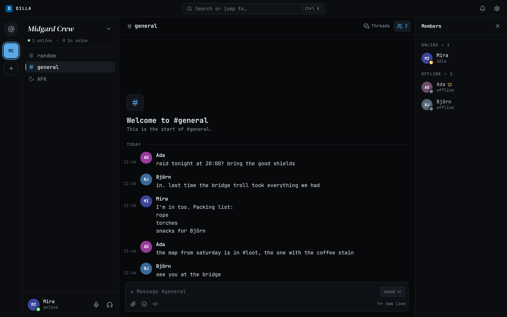
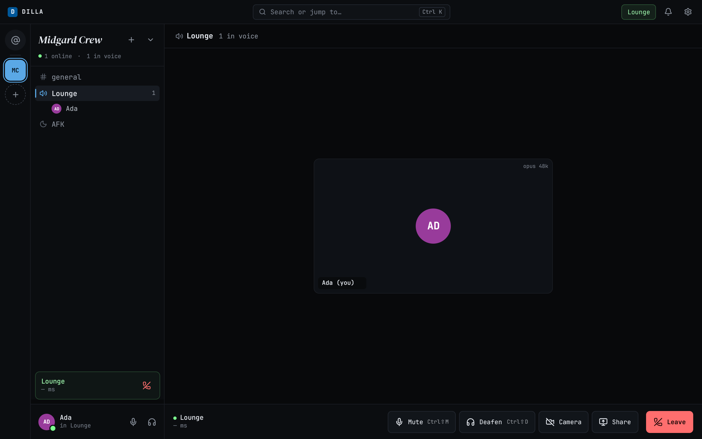
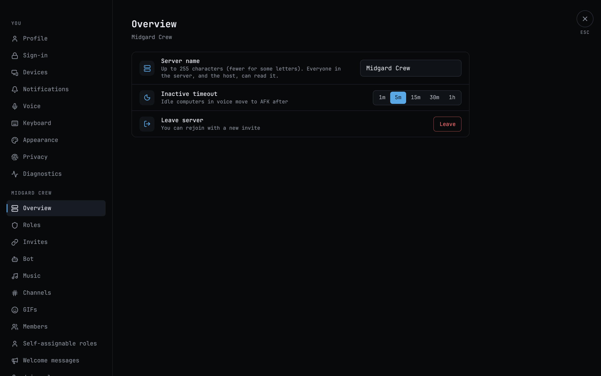
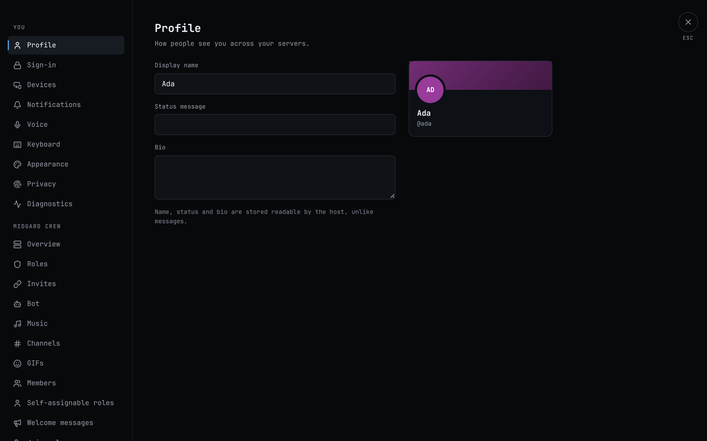
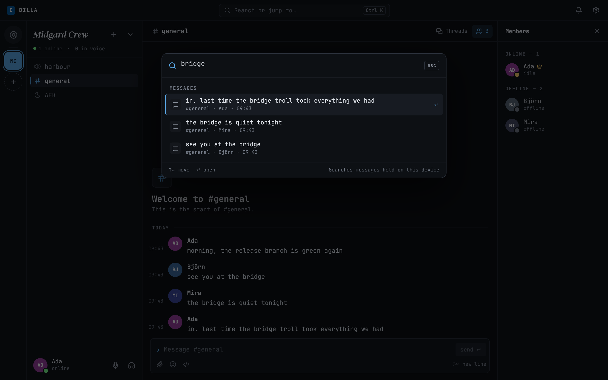
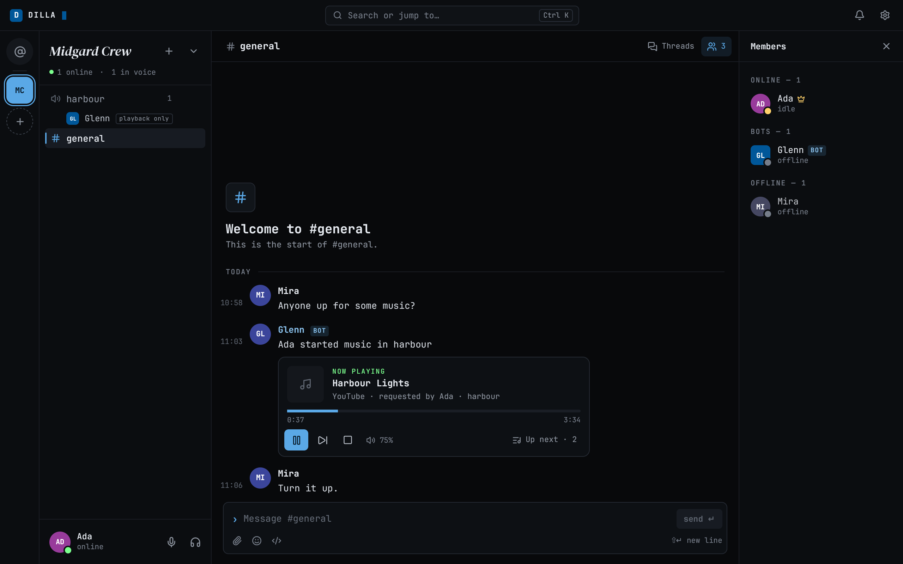
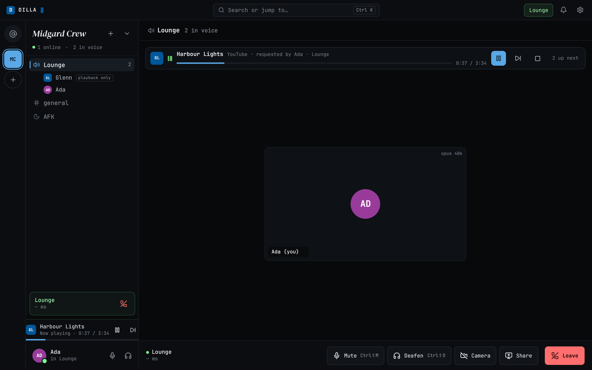
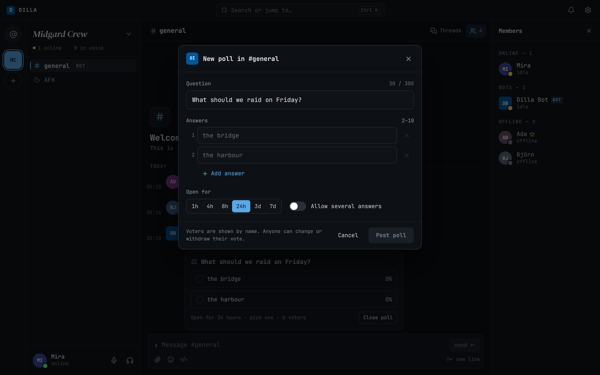
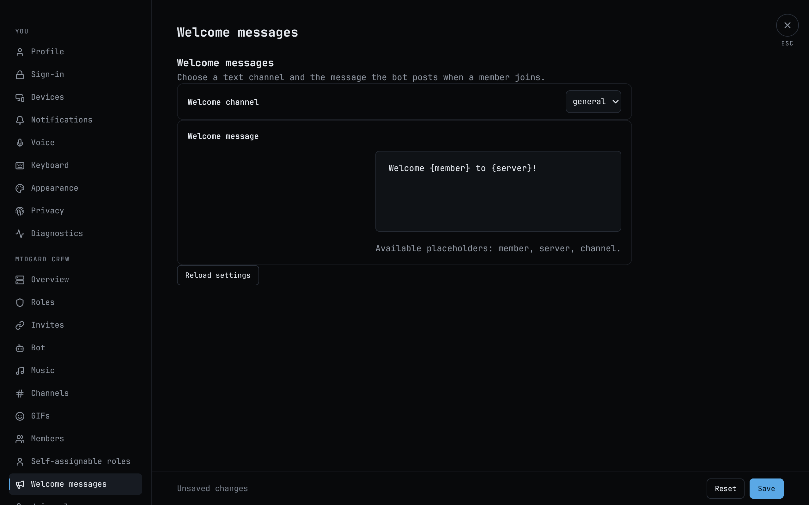

# Dilla desktop

The desktop client is the native Rust/GPUI program in `clients/desktop`. On Linux it is released as an **alpha**
(`desktop-gpui-v0.2.0-alpha.N`): an AppImage, a tar.gz, a deb, an rpm and an AUR recipe, [installed by
hand](#install-the-linux-alpha). From the first signed alpha on it checks for updates itself (the tray's "Check for
updates"). On macOS and Windows it is built from source.

**The Electron desktop app is discontinued.** Its last release is `desktop-v0.1.0-beta.5`. A copy you already
installed keeps working against a compatible server, but it gets no further updates and no fixes.

The desktop app needs a server at v0.1.0-signal1.5 or later. Passkey and identity-provider sign-in go through the
server's `/desktop-auth` routes; an older instance cannot take them, and the app says the instance needs an update.

## The native client (GPUI)

The native client is written in Rust with the GPUI toolkit (`clients/desktop`) and draws the Signal screens at pixel
parity with the Electron app on Linux. On Linux you install an alpha release; on macOS and Windows you build it from
source. The list of what works, screen by screen, is in the
[README](../../README.md#the-native-desktop-client-gpui).



### A tour

These are frames of the client itself (Linux, 1280 by 800 at twice the scale), shot from the app's test fixtures.



















### What the app does

**Everyday use**

- The app moves the way the Electron app did: new messages, menus, dialogs, toasts, badges, the speaking meter, the typing
  indicator and the caret animate. Settings → Appearance → Motion and your system's reduced-motion setting turn it
  down. Toasts (for example "Files over 25 MB can’t be sent") now show.
- Author names take the colour of their highest coloured role. Names sort by your system's language (the DM picker, the
  member lists and the @-mention list).
- The reply bar and the attachment tray sit over the message box. A direct message with something new has an unread dot.
- **Load earlier** at the top of a channel or a direct message fetches older messages (a long thread's pane has it too). A search result older
  than what is shown jumps to it.
- A channel row's menu (right-click or Shift+F10) sets how it notifies you (default, all messages, mentions or nothing) and has
  **Edit channel**.
- The call dock shows the link quality (the ping and the data rate, coloured when it is poor).
- Two banners explain a stopped state: "You are no longer in {server}." after you were removed, and "This server needs an
  update before this app can connect. Ask its admin." when the server is too old for the app.

#### Polls and commands

- Every built-in `/` command runs in channels and in threads. A command whose outcome is uncertain reopens its draft
  instead of sending twice ([the commands](bot-commands.md)).
- `/poll create` opens the poll form; polls work in threads.
- `/announcement create` schedules an announcement and `/rolepanel create` posts a role panel, both from the message box.
- The Bot's "started music" message carries a now-playing card, and the voice stage has a now-playing bar
  ([music](music.md)).

**Settings and moderation**

- A ban shows its details: who, when, why and for how long.
- Server settings → Welcome messages sets the channel and text the Bot welcomes new members with.
- Check boxes keep the Electron app's size, and the bio field in your profile can be dragged taller by its corner grip.
- Compact message density applies to the whole app.
- GIFs animate in the picker, in messages and in the preview, and stay still under reduced motion. A GIF picked in the
  picker is sent at once. Pictures and videos follow their rounded corners, and a click outside the picture closes the
  image preview.
- The member profile card closes on a click outside it or on Escape; **Message** and the compare (shield) button work.
- Your own tile, sidebar entry and avatar ring light while you speak, only while your microphone is really sending (not
  muted, deafened or paused, and not with push to talk up).

**Desktop only.** Two more things: a channel's menu also has **Mark as read** and **Copy link**, and a
thread's pane has **Load earlier** for a long thread.

### Install the Linux alpha

Download the files from the newest
[`desktop-gpui-v…` release](https://github.com/dilla-chat/dilla/releases?q=desktop-gpui&expanded=true) (the release
notes carry the same table). `<v>` is the release's version, for example `0.2.0-alpha.2`.

| System | File | Install |
|---|---|---|
| Ubuntu 24.04 or newer, Debian 13 | `dilla-<v>-linux-x64.deb` | `sudo apt install ./dilla-<v>-linux-x64.deb` |
| Fedora 40 or newer | `dilla-<v>-linux-x64.rpm` | `sudo dnf install ./dilla-<v>-linux-x64.rpm` |
| Arch | `dilla-<v>-linux-x64.aur.tar.gz` | Unpack it into an empty folder, read the `PKGBUILD`, then `makepkg -si` there |
| Any distribution | `dilla-<v>-linux-x64.AppImage` | `chmod +x dilla-<v>-linux-x64.AppImage`, then run it |
| Any distribution | `dilla-<v>-linux-x64.tar.gz` | Unpack it and run `dilla-<v>/dilla-desktop` |

The deb, rpm and Arch packages put the app in `/opt/Dilla`, start it as `dilla-desktop` and add "Dilla" to the
application menu. The Arch recipe (package `dilla-bin`) is a release file only: it is not on the AUR. It builds from
the release's own tar.gz, pinned by its checksum.

To check a download, keep `SHA256SUMS` beside the files and run `sha256sum --check --ignore-missing SHA256SUMS`;
`gh attestation verify <file> --repo dilla-chat/dilla` shows that GitHub Actions built it from this repository.

**What it needs.** glibc 2.39 or newer (Ubuntu 24.04, Debian 13, Fedora 40, Arch and newer); Vulkan or OpenGL ES 3
graphics; PipeWire or PulseAudio for calls; and a running **Secret Service**: GNOME Keyring, KWallet or KeePassXC.
Dilla keeps its database key there, so without one it cannot sign in. GNOME and KDE Plasma run one already; on other
desktops install and start one of them first. File dialogs and printing go through the XDG desktop portal, and colour
emoji need the Noto Color Emoji font. Application sound in a screen share needs nothing more on Linux; Windows and
macOS have their own floors (see Platform notes).

**Upgrading from Dilla beta (the Electron app).** The deb, rpm and Arch packages are named like beta's (`dilla`; the
Arch recipe provides and conflicts with `dilla`), so installing one replaces an installed beta.5 in place. Beta's
files in `/opt/Dilla` are removed (an rpm upgrade can leave its empty folders behind). Beta's app data stays on disk
but is not used, and nothing deletes it. The native app is a **new device** on your account (see below), so keep
another signed-in device and your recovery key at hand. Clicking a `dilla://` invite link opens the native app, as it
did in beta (the deb, rpm and Arch packages register
the scheme). An AppImage or tar.gz runs beside an installed
beta.

**Upgrading to alpha.2 on Linux.** The app id is now `chat.dilla.Dilla` (the desktop entry is
`chat.dilla.Dilla.desktop`, the icons `chat.dilla.Dilla.*`). Under the old id KDE Plasma showed no icon in the taskbar
and the launcher. The deb, rpm and Arch packages remove the old `dev.dilla.desktop.desktop` entry on upgrade, so a launcher you
pinned to it must be pinned again. An AppImage or tar.gz installs no desktop entry unless you integrated it yourself
(for example with AppImageLauncher, or by hand). An entry you made for it under the old name must be recreated with
`Icon=chat.dilla.Dilla` and `StartupWMClass=chat.dilla.Dilla`. With the deb, rpm and Arch packages, `dilla://` links keep
working. An entry you made by hand for an AppImage or tar.gz also needs `MimeType=x-scheme-handler/dilla;` (and `%U` on
its `Exec=` line) for them to open Dilla. macOS and Windows are unchanged.

### Install on macOS and Windows

From the first signed alpha on, the same release also carries:

| System | File | Install |
|---|---|---|
| macOS 13 or newer, Apple silicon | `dilla-<v>-mac-arm64.dmg` | Open it and drag **Dilla** to Applications. It is signed and notarized by Apple. |
| Windows 10 or 11, x64 | `dilla-<v>-win-x64-setup.exe` | Run it. It installs for your user only, into `%LOCALAPPDATA%\Programs\Dilla`, with no administrator prompt. |

The Windows installer is **not code-signed** during the alpha, so Windows SmartScreen says "Windows protected your
PC". Choose **More info**, check that the App line names the file you downloaded (the publisher shows as unknown), then
**Run anyway**.

**Upgrading from Dilla beta (the Electron app).**
- **Windows:** the installer removes an installed beta.5 for you first, keeping its app data, which the new app does
  not use.
- **macOS:** beta.5 is `dilla-desktop.app` in Applications, and the new app is `Dilla.app`, so dragging it in leaves
  beta.5 beside it. Move `dilla-desktop.app` to the Bin. Both have the same bundle id and signer, so the microphone and
  camera permissions you gave beta should carry over; macOS may ask for screen recording again.

As on Linux, the native app is a **new device** on your account.

### Build and run it

You need the pinned Rust toolchain (`rust-toolchain.toml`) and, on Linux, clang 21 or newer and the X11 and Wayland
development packages (the list is in `.github/workflows/desktop-gpui.yml`). From the repository root:

```sh
# Linux
CC=clang-21 CXX=clang++-21 cargo run -p dilla-desktop
# macOS: Xcode with its Metal Toolchain (a separate download in recent Xcode versions, needed once)
xcodebuild -downloadComponent MetalToolchain
cargo run -p dilla-desktop
# Windows (PowerShell): libwebrtc uses the static MSVC runtime
$env:RUSTFLAGS="-C target-feature=+crt-static"; cargo run -p dilla-desktop
```

The first window is "Dilla - your instances". Type the instance's address (HTTPS) to connect, or paste an invite to
join, then sign in or sign up. Each instance gets its own window; `--instance=<n>` opens only instance `n` (a second
copy of the app on another instance, beside the first), and a debug build accepts `--allow-loopback` for an
`http://localhost` test instance. Per-OS build notes are in `clients/desktop/README.md`. The Invite link field takes
the link the instance shows under Server settings → Invites (`https://<instance>/i/<code>`) as well as a
`dilla://invite/<host>/<code>` link.

**A second profile (a testing aid).** To run two separate clients on one machine (two accounts talking to each
other, or CI), start the second with `DILLA_DATA_DIR` set to an absolute folder of its own:

```sh
DILLA_DATA_DIR="$HOME/dilla-profile-b" dilla-desktop
```

Everything of a profile lives in its folder: the instance list, the stores, the lock that keeps one app per profile
and the socket a second launch hands over through, so the two run side by side and a second launch reaches only its
own profile's app. The database keys stay in the operating system's keychain, named by each profile's own install id,
so the two profiles never share a key. A relative path is refused (the app says it cannot store anything); unset or
empty, the usual data folder is used.

The client keeps its data apart from any installed Electron app. Like it, it is a **new device** on your
account: sign in, complete your second factor, then enrol it with your saved 52-character recovery key. Messages sent
before it joined are not shown on it. Keep another signed-in device and the recovery key at hand.

### How it works

- It is one native program. The store, the keys (in the
  operating system's keychain) and the end-to-end encryption run in the same process.
- One window and one client per instance. Opening an instance from "Dilla - your instances" closes that window (the
  instance's window replaces it); "Your instances…" in the tray or the app menu brings it back. Closing a window keeps its client running until you remove the instance or
  quit the app; opening the instance again shows a new window on the running client.
- One app for all instances (per profile): starting Dilla again brings the running app forward, and a `dilla://invite/<host>/<code>`
  link opens that instance's join step (an instance you have not added yet is asked about first).
- Quitting during a call, or with files waiting to be sent or text typed in the last moment, asks first ("Quit
  Dilla?"). Drafts are kept per channel across restarts. A microphone the operating system blocks joins calls
  listen-only, with a notice.
- Inline audio plays in the app (MP3, AAC, Vorbis, Opus, FLAC, WAV). Videos play in their card too: WebM and MP4 with VP8, VP9, AV1 or H.264 (H.264 not on macOS yet), with play and pause, the timeline, volume
  and full screen (Escape leaves it). The ⋮ menu downloads the video, sets the playback speed (0.25× to 2×) and moves
  it to a small picture-in-picture window (back returns it to its card; close also pauses it). A video the app cannot decode (Ogg Theora, H.265, and H.264 on macOS) opens
  in your system's player instead; a copy handed to the player is deleted when the app starts and quits.
- Message search runs on this device's own decrypted history.
- The screens are drawn by the app itself, so the keyboard works through the app's own focus order
  (Tab and Shift+Tab) and its own shortcuts, below.

### Logs

When something fails (a call that does not join, an update that does not apply), the app's log says why. It is a
plain text file, also printed to the terminal when Dilla runs from one:

| System | Log file |
|---|---|
| macOS | `~/Library/Logs/Dilla/dilla-desktop.log` (Console.app lists it under Log Reports) |
| Linux | `$XDG_STATE_HOME/dilla/dilla-desktop.log`, usually `~/.local/state/dilla/dilla-desktop.log` |
| Windows | `%LOCALAPPDATA%\Dilla\logs\dilla-desktop.log` |

At about 5 MiB the file moves to `dilla-desktop.log.1` (the one before that is deleted). By default it holds warnings
and errors, and Dilla's own progress notes. For more, start the app with `RUST_LOG` set, for example
`RUST_LOG=debug` or `RUST_LOG=warn,dilla=debug,livekit=info` (a level, or `name=level` pairs separated by commas; a
name matches every module whose name starts with it). On macOS, quit Dilla and run
`open --env RUST_LOG=debug /Applications/Dilla.app`. The log never contains message text, keys, tokens,
passwords or recovery codes, so you can attach it to a bug report.

### Keyboard shortcuts

The Windows and Linux keys use Control; on macOS a chord takes ⌘ where the table says so (Control+End and
Control+/ stay Control there).

| Windows and Linux | macOS | What it does |
|---|---|---|
| Control+K, Control+/ | ⌘+K, Control+/ | Opens search (Escape closes it; the arrows choose, Enter opens) |
| Control+, | ⌘+, | Opens your settings |
| Alt+Arrow Up, Alt+Arrow Down | ⌥+Arrow Up, ⌥+Arrow Down | Opens the previous or next channel |
| Alt+Arrow Left, Alt+Arrow Right | ⌥+Arrow Left, ⌥+Arrow Right | Goes back or forward through the places you have been |
| Control+Shift+M | ⌘+Shift+M | Mutes or unmutes, in a call or before the next one |
| Control+Shift+D | ⌘+Shift+D | Deafens or undeafens, in a call or before the next one |
| Control+End | Control+End | Jumps the open conversation to its newest message |
| Control+Shift+Enter | ⌘+Shift+Enter | Starts the open direct message's call |
| Push-to-talk key (Settings → Voice) | the same | Opens the microphone while held, in a call, when this window has focus and no text field does |
| Page Up, Page Down | the same | Scrolls the message log |
| Up, in an empty composer | the same | Edits your newest message |
| Enter, Shift+Enter | the same | Sends, starts a new line |
| Tab, Shift+Tab | the same | Next and previous control; a dialog keeps them inside |
| Escape | the same | Closes the open search, dialog, thread pane, lightbox or GIF picker |
| Enter, Escape on an incoming ring | the same | Answers, declines |
| Arrow Up, Arrow Down, Tab, Enter, Escape in the `/` list | the same | Chooses, completes, runs, closes |

Settings → Keyboard lists seven of these. A direct message's header has no call button: right-click the direct message in the list for its menu, which starts (or joins) its call and opens its pinned
messages.

### Platform notes

What works the same on every system is described above. These are the places where the systems differ, and
what the client still does not do.

- **Tray and background:** the tray icon (its menu lists your open instances, "Start Dilla at login" and "Quit
  Dilla"), close to tray, the unread count (the tray's tooltip; the dock badge on macOS; the launcher badge on KDE and
  Ubuntu's dock) and start at login (in the tray, with no window) work. A start at login connects every instance, so
  rings and messages notify from the tray with no window open. It never asks for the keychain at login: an instance
  whose key cannot be read without a prompt (a locked keyring, or no Secret Service) connects when you open its
  window. KeePassXC set to "confirm when passwords are retrieved" can still show its own confirmation. After a
  start at login the dock or launcher unread badge updates once a window is open. GNOME shows no tray without the
  AppIndicator extension, and then closing the last window quits, as before. Start at login is offered in installed
  (release) builds only. The ☰ button at the left of the title bar (and of "Dilla - your instances") opens the app
  menu (the system's own menu on macOS and Windows); F11 (Control-⌘-F on macOS) toggles full screen. On macOS
  the Dilla menu also has About Dilla, Settings… (⌘,), Services, Hide Dilla (⌘H), Hide Others (⌥⌘H), Show All and Quit
  Dilla (⌘Q, which asks first during a call as above); Window has Minimize (⌘M) and Bring All to Front. The sign-in and
  sign-up windows are moved by their top edge and closed with the × in their top-right corner, on every system.
- **Deep links:** clicking a `dilla://invite/...` link opens it in Dilla, started if it is not running: the deb, rpm
  and Arch packages register the `dilla:` scheme in the desktop entry, the macOS app in its Info.plist (the link
  reaches a running app as an open-URL event) and the Windows installer per user in the registry (removed on
  uninstall). A second launch hands the link to the running app and exits. An AppImage registers it only through an
  integration tool such as AppImageLauncher or appimaged; the tar.gz does not register it. Passing the link on the
  command line works everywhere.
- **Updater and packaging:** from the first signed alpha on, the app checks its signed update feed at start, every 6
  hours and on the tray's "Check for updates". An AppImage, the macOS app in a folder you can write to and the Windows
  per-user install download the update, check it (the feed's signature, the file's size and SHA-512, and on macOS the
  Developer ID signature) and offer "Restart to update"; the restart asks first when a call or unsent text would be
  lost. A deb, rpm, AUR or tar.gz install only says that a new version is available: update it with your package
  manager or from the release page. An alpha before the first signed one does not check: download the next alpha by
  hand. Linux has an AppImage, a tar.gz, a deb, an rpm and an AUR recipe (a release file, not on the AUR).
- **Screen capture and camera:** sharing a screen or a window works. Share opens the share panel above the Share button
  (quality and frame rate); Go live opens Dilla's picker with a thumbnail of every screen and window. On KDE Plasma
  (Wayland) the picker is Dilla's own too: Plasma 6.8 or newer needs nothing, and Plasma 6.0 to 6.7 needs the deb, rpm
  or AUR package installed (Plasma trusts the installed app; the AppImage and the tar.gz get the system's dialog there).
  Elsewhere on Wayland (GNOME, and a Flatpak or Snap build) the system's own dialog chooses, every time; after you pick,
  the share panel opens again so you can add an application's sound. On macOS the first share asks for Screen Recording
  permission (System Settings → Privacy & Security → Screen Recording); after you allow it, quit and reopen Dilla. macOS
  15 and newer may ask again from time to time whether Dilla may keep recording the screen. A share can carry the sound
  of one application (the share menu's sound section) on Linux, on Windows 10 version 2004 (build 19041) or newer, and
  on macOS 14.2 or newer. On an older Windows or macOS the share has no application sound. Sharing a window brings that
  window's application's sound by itself, and the sound section then reads "Sound from {app}". You can switch it off
  there or choose another application, for that share only: every new share starts again from what it shares. Sharing a
  whole screen brings no application's sound unless you choose one. Nothing is chosen for you where the system's dialog
  picks the window (Wayland outside KDE Plasma), when the window's application isn't playing, or for Windows Store apps.
  The sound row is in the panel while you share, not before. Dilla's own sound is never shared. macOS may ask for
  permission to record system audio the first time. The camera works on Linux, Windows and macOS (the built-in camera,
  an external one, and Continuity Camera on macOS 14 or newer). Your own tiles show what you send: your share, and your
  camera mirrored as a mirror shows you (the others see it the right way round).
- **Screen readers:** the app exposes itself to Orca, VoiceOver and NVDA through AccessKit: every control is named, the shell has
  its landmarks (servers, channels, the message log, the call controls), messages are read with their author and time,
  and new messages, rings, joining or leaving a call and the microphone and sound switches are announced. Tab reaches
  the newest message; Up, Down, Home and End step through the messages, Tab reaches the focused message's actions and
  Escape goes back to the composer. The recovery key and an authenticator's setup key are read out only on request: Tab to "Read aloud" beside them
  (shown while it has the focus) and press it; the key is read once, in groups of four.
- **Push to talk outside the window:** the key works only while the app has focus. Operating-system-wide push to talk
  comes after the switch.
- **Video playback speed:** a speed other than Normal changes the pitch of the sound.
- **Picture in picture on Wayland:** the window opens, but the compositor decides whether it stays above the others
  (as for any window); on X11 it stays on top but cannot be dragged.

## Notifications

Dilla raises an operating-system notification for a new message, a mention or a ring while you are not looking at it.

<!-- notification-linux.png: added after the shot -->

**What raises one**

- **Messages and mentions.** A message in a channel or a direct message notifies you as your settings say: the
  **Desktop notifications** switch on this device, the system's permission, your do not disturb status, a muted server
  or channel, and the notify mode that applies (**All**, **Mentions** or **Nothing**). Nothing pops up for the channel
  you are looking at in a focused window. Your server, channel and mention settings are in
  [Notifications for a server](getting-started.md#notifications-for-a-server) and
  [Badges, direct messages and notifications](getting-started.md#8-badges-direct-messages-and-notifications).
- **Rings.** A call that rings you raises a notification with **Answer** and **Decline**, silent because Dilla plays
  the ring itself, while no window of that instance is focused. It works with every window closed to the tray too:
  Answer opens the window, which answers. The tray lists each live ring with the same two rows. When the ring ends,
  or you focus that instance's window again, the notification is withdrawn (closing the window does not withdraw it
  while it rings).

**What it says**

- A channel message: the title is "#channel · Server" and the body is the message text, cut at 200 characters.
- A direct message: the title is the sender's name and the body is the text.
- A mention reads like a message in the channel where it was made; `<@...>` mentions in the text show as the names
  the timeline shows.

**What a click does.** Clicking the notification brings the instance's window forward and opens that conversation.
With every window closed to the tray, it opens the instance's window.

**Replacing.** Notifications are kept per conversation: a newer message in the same conversation replaces the
earlier notification instead of stacking. The most that stay up at once is 64; after that the oldest is withdrawn
to make room. Closing a window withdraws its instance's message notifications.

**Turning them off.** In Settings → **Notifications**, switch **Desktop notifications** off on this device, or mute
or set a server or channel to **Nothing** (a channel's row menu in the channel list). Setting your status to do not
disturb silences them on every device. If the system blocks them, the setting says so and you allow Dilla in the
system's notification settings.

**On your system**

- **Linux** shows them through the desktop's notification service, and a newer message in a conversation replaces
  the earlier one there.
- **Windows** needs the installer's Start-menu entry; a build run from source does not show them.
- **macOS** shows them only from the app bundle; a build run from source does not.

A build run from source therefore shows notifications on Linux only.

**Privacy.** The notification carries the sender, the channel and up to 200 characters of a message the app has
already decrypted, and your operating system displays it, so on a shared or recorded screen the popup shows message
text. The app has no setting to hide the text in a notification: switch **Desktop notifications** off, or set the
conversation to **Nothing**, if that matters. Nothing else leaves the app.

## Enrolling the desktop app on an existing account

For an existing account the desktop app is a **new device**. Sign in through the configured account flow, complete any
required second factor, then use the **saved 52-character recovery key** to enrol it. A password alone cannot unlock the
account's keys on a fresh device. Backup codes replace a second factor; they are not the recovery key. This is the
ordinary recovery-key enrolment, not device linking or key export.

Messages sent before a new device joins are not shown on it. Keep an already signed-in device until you have confirmed
that the desktop account, its identity and its conversations are there, and do not sign out, revoke or forget that
device while it is needed. If the saved recovery key is unavailable, keep the working device and do not remove it.

The server has an explicit `dillad serve` flag, `--desktop-downloads`, which defaults to **false**. When it is on, the
instance's `/download` page offers the desktop app, and **Open Dilla desktop** on a public invite uses the
`dilla://invite/<HTTPS host[:port]>/<code>` link, which carries no credentials. Path-scoped instances still need the
complete HTTPS instance URL and the displayed code pasted in. Leave the flag off until a native desktop build is
released: the download page links to the fixed `desktop-beta` release aliases, which are the discontinued Electron builds.

## Electron app (discontinued)

The Electron client was a bundled copy of the React client with a local shell. Its last release is
[`desktop-v0.1.0-beta.5`](https://github.com/dilla-chat/dilla/releases/tag/desktop-v0.1.0-beta.5); its source is at that
tag under `packages/desktop`. It is no longer built, tested or released from this repository, and installed copies
get no further updates. If you still run it, move to the native client, and
enrol the new device with your recovery key as described above.
