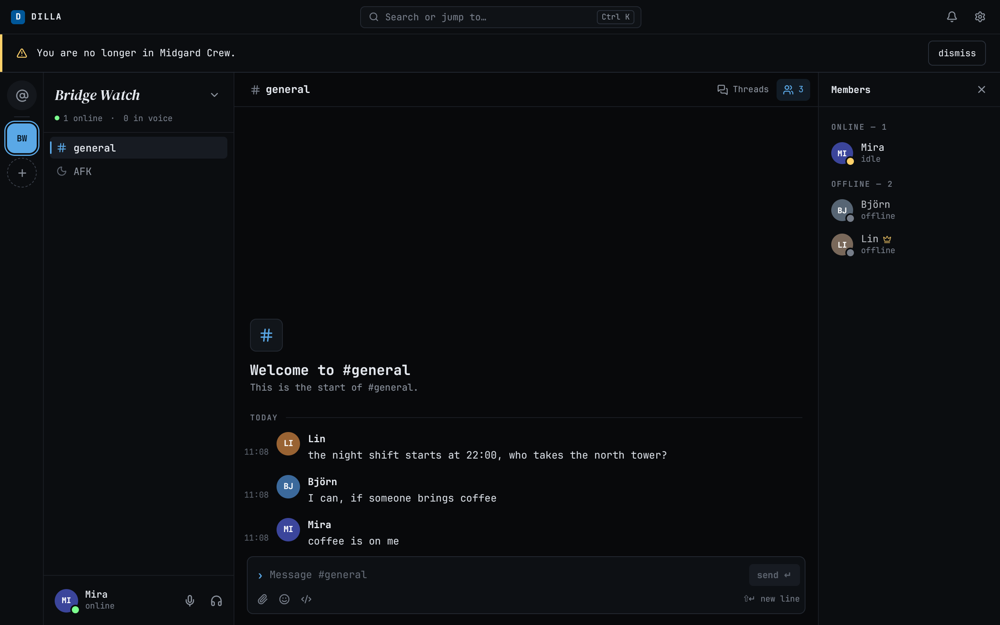
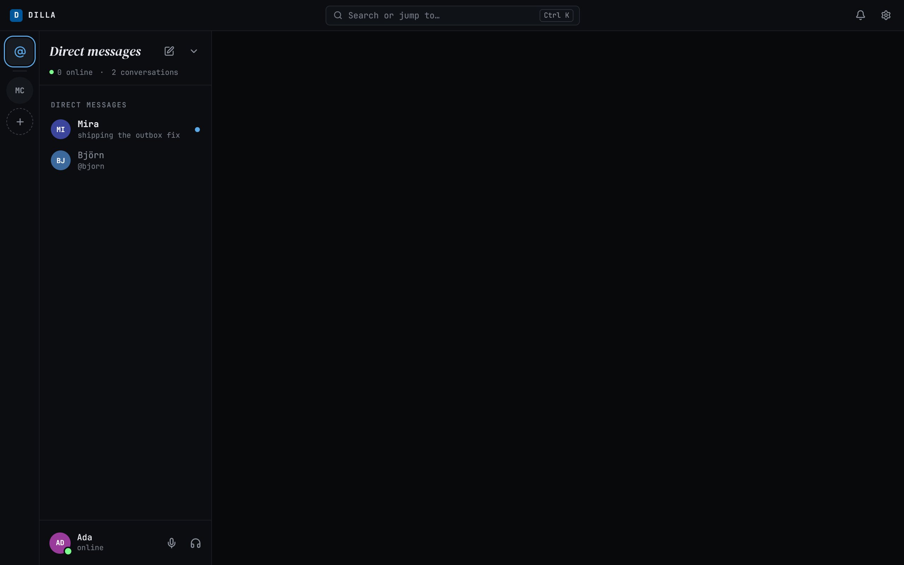
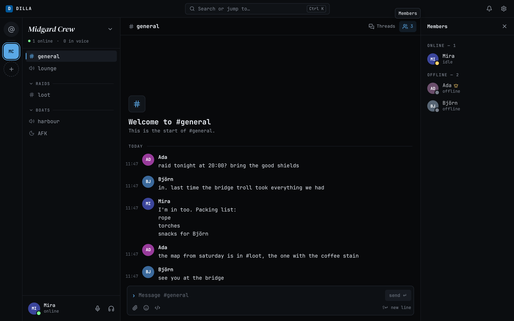
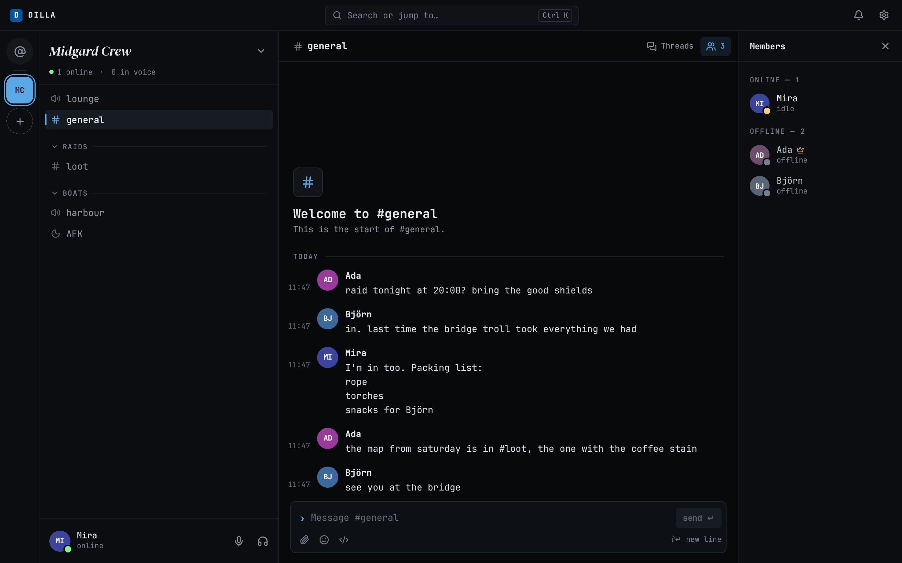
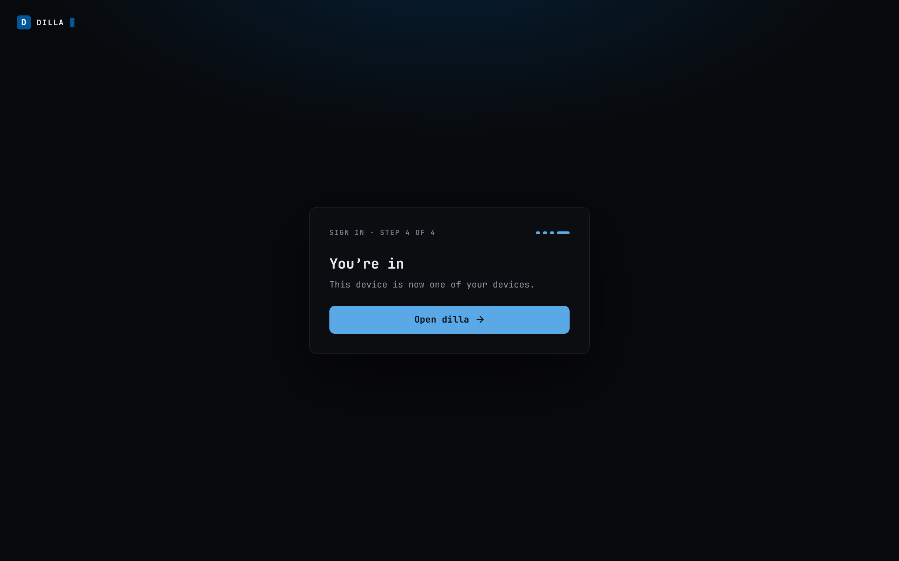
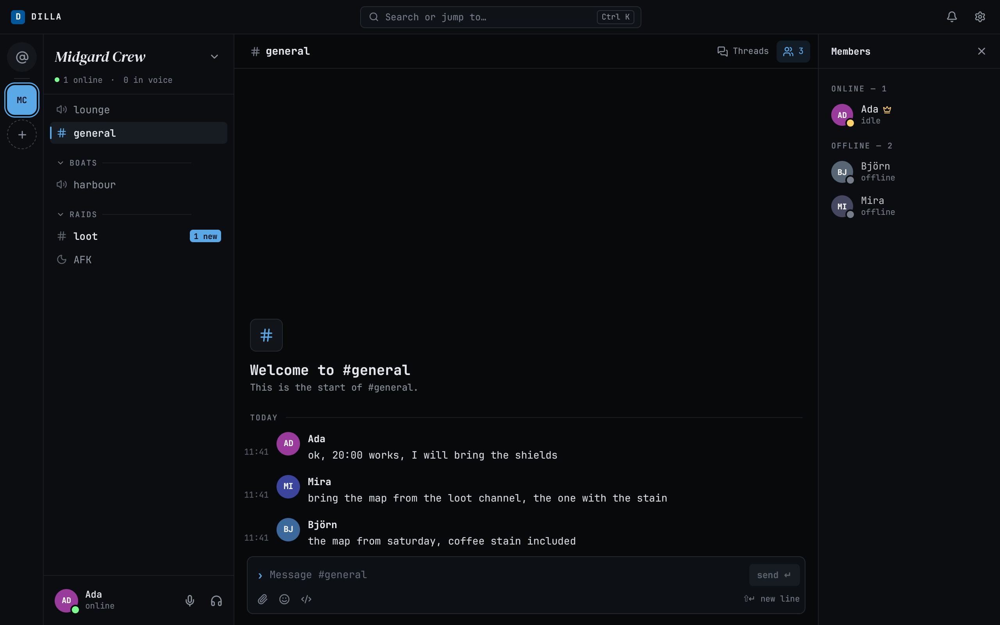
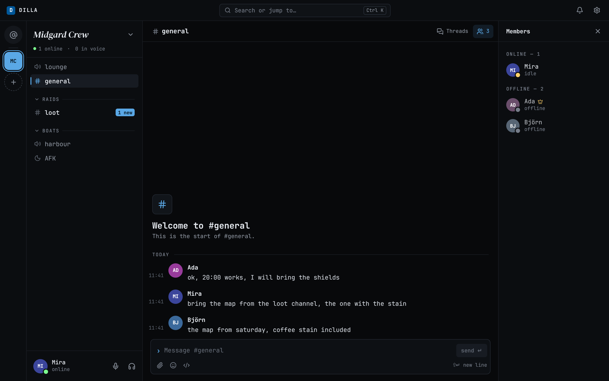
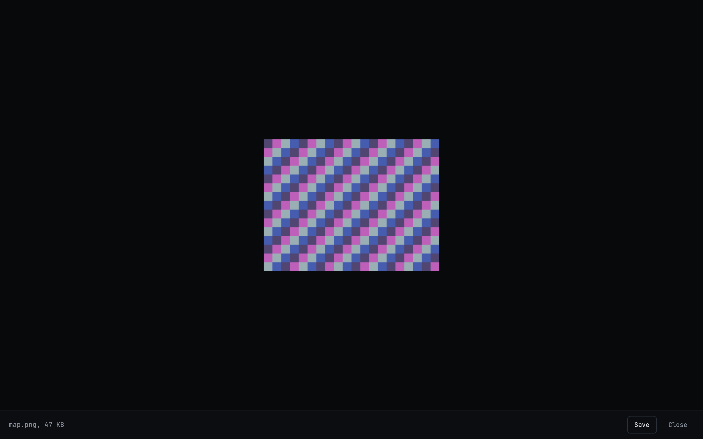

# Getting started with dilla

This page is for a person who has been sent an invite to a dilla instance, and for the first person on a new
one. It describes the desktop app with the Signal design: starting a server, inviting people and adding
channels, roles, slow mode, announcement channels and threads, signing up, the second factor every account has, using the account on a second device, devices, channels,
direct messages, badges and notifications, saying more (edits, deletes, reactions, replies, pins, mentions,
images and files), contacts and safety numbers, search, settings, and what the
client cannot do yet. Every quoted line is the text the screen shows;
`{instance}` stands for the instance's address, `{username}` for yours and `{server}` for a server's name.

If you were sent an invite, go to [1. Open the invite](#1-open-the-invite). If you are the first person on a new
instance, start with [Start a server](#start-a-server).

If you run the instance yourself, start with the [operator guide](../deploy/README.md). For voice channels, calls
in direct messages, camera and screen share, push to talk, sounds, and audio and video files, read
[Voice, calls and media files](voice.md) next.

## Start a server

This section is for the first person on a new instance. Whoever installed it got a bootstrap invite link from
`dillad init` (or from the install script), shown once. It looks like `https://chat.example.org/i/<code>`, is valid
for 24 hours and can be used once. It is an invite to the instance, not to a server.

1. Open Dilla, connect to the instance and paste the bootstrap link into the first step of the sign-up: the same six
   steps as [an invited person](#2-sign-up-six-steps).
2. **Open dilla** opens the app, which has no server in it yet:

   

   "You are not in a server yet" "Start a server and invite your friends, or join one with an invite someone sent
   you." The sidebar stands on **direct messages**: it says "no direct messages yet" and offers **message someone**.
   Pressing that opens a picker which says "There is no one to message yet: direct messages are with people you share
   a server with. Start a server and invite someone, or join one."
3. Press **Start a server**, or the **+** tile ("add a server") in the server rail and then **new server**. With the
   keyboard, Tab to the rail, which is one stop, then press the Down arrow (or End) until **add a server** has focus,
   and press Enter. The dialog
   "Start a server" says "You own it: you add its channels and invite people. It starts with a text channel and a
   voice channel, both called general."

   

4. Type a name under "Server name" ("Up to 255 characters (fewer for some letters).") and press **Create** or Enter. While it works the button
   says "Creating…"; a second press sends nothing more.
5. The dialog closes, the server is selected and `#general` opens with the cursor in its message field. The server
   also has a voice channel called general. You are its owner.

The server rail is now: the **@** tile for your direct messages at the top, a line, your servers, and one dashed **+**
tile ("add a server") under them. The **+** opens one window, "add a server", with two choices: **join a server**, for an
invite someone sent you, and **new server**. Beside the server's name sits the **⌄** server menu (settings, mute, notifications), and the owner has a
**+** ("new channel") at the top of the channel list. Invite links are made in server settings, under **invites**
([Invite people](#invite-people)).

If the server is not created, the name field says why:

| The dialog shows | What to do |
|---|---|
| "Give the server a name." | Type a name; spaces alone are not a name |
| "That name is too long. A server name is up to 255 characters (fewer for some letters)." | Shorten it. The limit is counted in bytes: letters such as å or ü take two each, and an emoji four or more |
| "A name cannot hold control characters such as tabs or line breaks." | Take them out |
| "That name was refused. Try another." | The instance refused it; choose another |
| "Could not start the server ({code}). Try again." | Press **Create** again. After E_NETWORK the server may have been made anyway: the dialog reads your server list again, and if the server is there it carries on with it. **Create** with the same name reads the list again before it makes anything, so it never makes a second server |
| "{server} is ready, but #general was not added ({code}). Try again, or close this and add it from the channel list." | The server exists. **Try again** adds only what is missing; the same message names the voice channel general, or both channels, when those are missing. Closing the dialog keeps the server as it is. If you closed the dialog while the channels were still being added and one of them failed, the next time you open "Start a server" it shows this message once, with **Try again** |

## Invite people

Anyone whose roles allow it can make an invite link to a server; by default that is every member. Open the **⌄** server menu beside the server's name and choose **Server settings**
(or press the settings button in the top bar). It opens on the first section you may use, so a member who may only invite lands
on **invites** ("Anyone with a link can join {server}."). Choose "Expires after" (1 hour, 1 day, 7 days or never) and
"Uses" (1, 10 or ∞; 7 days and 10 to start with) and press **Make invite link**. **never** and **∞** are offered only
to people who may manage the server: a link that never runs out is a standing way in. The link shows once, with
**Copy** and "It can be used 10 times and expires in 7 days. The link is shown only once."; **Copy** puts it on your
clipboard and files it under "Active links", where each link shows its uses and expiry and has **Revoke**.

The **/invite** command, typed in the message field, makes a quick link (7 days, 10 uses) in a dialog:

- The dialog repeats what you chose ("Expires after: 7 days. Max uses: 10 uses.") and that "The server keeps only a
  fingerprint of each link, so a link cannot be shown again. Make a new one to share." Send the link only to the
  people you want in the server.
- "Invite link copied." means it is on your clipboard. If the app could not copy it, the dialog says
  "This device did not copy the link. Press copy link to try again, or select the link and copy it yourself."
  Selecting the field selects the whole link.
- Each person who joins with the link uses it once, whether they sign up through it or already have an account. So
  a link of 10 uses brings in up to ten people. Every press of **Make link** makes a new link.
- "You cannot invite people to this server." or "Could not make an invite link ({code})." means no link was made;
  **Try again** asks again.

Your friend opens the link and sees the instance's invite page ([1. Open the invite](#1-open-the-invite)), signs
up in six steps, and lands in your server with its channels. They can message you from **direct messages**.

**Post your welcome after your friends have joined.** A friend does not see messages sent before their app
joined: that is how the end-to-end encryption works, since their app was not yet a member when those messages
were sent. Their `#general` starts at the moment they joined and says "nothing here yet. Messages sent before this
app joined are not shown." Everything sent after that reaches them.

## Add a channel

The owner, and anyone whose roles let them manage channels, sees a **+** ("new channel") at the top of the channel
list while the server has no categories. Once it has categories, each category has its own **+** ("new channel in
{name}"), which shows when you point at the category or tab to it, and the new channel starts in that category. The
**+** is never on the direct messages list, and a person who may not manage channels has none. Press it.

1. Under "Kind", choose **text**, **voice** or **announcement** ([Announcement channels](#announcement-channels)). The
   arrow keys move between them. **private channel** keeps the channel to the owner, administrators and the roles you
   tick ([Private channels](#private-channels)).
2. Type a name under "Channel name". The line under the field shows how it will look: "Shown as #{name}. Up to 100
   characters (fewer for some letters)." for a text channel. A text channel's name is kept in lower case, with spaces turned into hyphens:
   "Fika på Fredag" becomes `#fika-på-fredag`. A voice channel keeps the name as you typed it.
3. Press **Create** or Enter ("Creating…"). A new text channel opens with the cursor in its message field and says
   "nothing here yet."; a new voice channel is listed among the others, in the server's order.

The dialog does not add a second channel of the same kind and name. If the name is taken, it says "There
is already a text channel called #{name}. Try another." (or "There is already a voice channel called {name}. Try
another.") and nothing is created.

The others in the server see a new channel within about a second, in any dilla app they have open; a renamed
server's new name shows the same way. The dialog says "Give the channel a name.", "That name is too long. A channel name is up
to 100 characters (fewer for some letters).", "A name cannot hold control characters such as tabs or line breaks.", "You cannot add channels to
this server.", "That name was refused. Try another." or "Could not add the channel ({code}). Try again." when the
channel was not added.

## Run your server

Once a server has people in it, you run it from **server settings** and from the member list. Both are for people
whose roles allow it; the owner can do everything here.

### Server settings

Open the **⌄** server menu beside the server's name and choose **Server settings**, or press the settings button
in the top bar. Server settings is the full-screen settings workspace, the same one as your own settings, with the
server's sections in its list. A section shows only to someone whose roles allow it: **overview** (manage the server),
**channels** (manage channels), **invites** (create invites) and **bans** (ban members). It opens on the
first section you may see. **Leave server** is in **Overview**, and the owner sees **delete server** and **hand over server**
too. Leaving a server lives here, not in the sidebar. Escape closes the workspace and focus goes back to where you came from.

**Overview** renames the server. Type under "Server name" ("Up to 255 characters (fewer for some letters). Everyone in the server, and the host,
can read it.") and press **Save**: "Saving…", then "Saved." The field says why when it did not work: "Give the server
a name.", "That name is too long. A server name is up to 255 characters (fewer for some letters).", "That name was refused. Try another.", "You
cannot rename this server." or "Could not save ({code}). Try again." If "Someone else changed the server at the same
time. Check the name and save again.

Under the name, **Overview** holds the **Inactive timeout** ("Idle computers in voice move to AFK after"): how long someone
can sit idle in a voice channel on a computer before the server disconnects them and lists them as away in the server's AFK
channel. Choose 1m, 5m (the default), 15m, 30m or 1h, and press **Save**. The same card ends with
**Leave server** ("You can rejoin with a new invite"): **Leave** asks first; an owner is told to hand the server over or
delete it instead.
There is no AFK channel to pick: every server has one called "AFK" ([Voice, calls and media
files](voice.md#afk-channels)).

The field says why when saving did not work: "Someone else changed the server at the same time. Check the name and save
again." means you should look at the name that is there now and save again.

**Channels** lists the channels under their categories ("no category" holds the rest). Each row has **edit**, **move
up**, **move down** and **delete**; the screen announces "{name} moved." after a move.

- **new category** asks for a "Category name" ("Up to 100 characters (fewer for some letters). A category groups channels in the list; it holds no
  messages.") and **Create**.
- **edit** opens "Edit #{name}" (or "Edit {name}" for a voice channel, "Edit category {name}" for a category). You
  can change the "Channel name" ("Up to 100 characters (fewer for some letters)."), the "Topic" of a text channel ("Shown under the channel name.
  Up to 1024 characters (fewer for some letters). The host can read it.") and its "Category". A category has only a name. The channel's row menu in the channel list has the same
  **edit channel** for whoever may manage channels; it opens this dialog for that channel.
- The **AFK** channel is in the list too. It has **edit** (its name and category only, with "This is the server’s AFK
  channel. Nobody is connected here; people who are away are listed."), and no **delete** and no move up or down: it can be renamed and moved to another
  category, but it always stays last in its list.
- **delete** asks "Delete #{name}?". A text channel "is removed for everyone, with its messages and files. Copies
  someone already saved stay with them. This cannot be undone." A voice channel is removed too and a call in it
  ends. Deleting a category keeps its channels, without a category. Focus starts on **Cancel**.

**Invites** makes and lists invite links, as in [Invite people](#invite-people). Under "Active links" each live
link shows its uses ("3 / 10 uses", or "3 / ∞ uses" with no limit) and its expiry ("expires {date}", or "expires
never"), with **Revoke**. **Invites** is open to everyone whose roles allow them to invite, not only to the owner.

A link that never expires or has no use limit keeps working after the person who made it loses the right to make
one, or leaves the server: revoke it from "Active links" if it should stop. Such links are marked "∞" or "expires
never" in the list.

Invite links cannot be shown again. "The server keeps only a fingerprint of each link, so a link cannot be shown
again. Make a new one to share." Copy a link when you make it; if it is lost, revoke it and make another.

**Bans** lists who is banned from the server, with "banned by {name} on {date}", when it ends ("ends {date}" or
"until lifted"), and the reason or "no reason given". A ban that has run out says "ended {date}; can join again". A
moderator who has since left the server shows as "a former member", and an account the instance no longer names as
"a deleted account". **unban** asks "Unban {name}?": "{name} can join {server} again with an invite. This does not add them
back." An empty list says "Nobody is banned from {server}." If the list does not load, **Try again** loads it
again.

### Bot channels, webhooks and the Bot section

The server's Bot answers commands and posts for features such as music, polls, reminders and welcome messages. It
joins only the text channels you mark as **Bot channels**, and it posts only there. In **Server settings → Channels**,
**edit** a text channel and turn on **Bot channel**. The channel then shows a **Bot** tag. Nothing is marked for you:
the features that post (welcome messages, announcements, role panels, polls, the music card) wait until you pick a
Bot channel for them.

**Server settings → Bot** is the Bot's section. It has a switch for each part of the Bot, a health line ("Commands
are working", "Commands failing since 06:24" or "The Bot is offline since 06:24") with the Bot's command key, the list
of Bot channels, and **Webhooks**. A webhook lets a script or a game server post into one Bot channel with a
`curl` command. Its address is shown once when you create it. How to create one, what to send and what the answers
mean are in [Bot commands](bot-commands.md#webhooks).

A command you cannot run yet stays in the picker, greyed, with the reason. See [Greyed
commands](bot-commands.md#greyed-commands).

### Members

The **members** button in the channel header opens the list of "members of {server}", grouped by role: one group
for each role shown apart, highest first ("{name} — {count}"), then "members". A row is the avatar with its status
dot and the name, centred in the row; there are no "owner" or "you" tags in it, and a bot keeps a small "bot" tag after its name, as in Discord. A person's name is drawn in the colour of their highest
coloured role (in the normal text colour when that colour would be hard to read in your theme), and the owner has a small
crown after the name. A person who has set a status line shows it under the name, and then the row is two lines tall. On a
wide window the list is a column beside the conversation. In a window narrower than 64 rem it is a panel
over the screen: focus moves into it, and **close members**, Escape or a click outside it closes it. Focus goes back to
**members**.

A whole row is one button. Click it, press Enter on it, right-click it, or press Shift+F10 or the ContextMenu key with the
row focused, and it opens that person's **profile card**. The card is a popover beside the row; it closes on a click outside it or on Escape, and its banner follows the round corners. A long name wraps and a long bio scrolls. **Message** opens the direct message and the shield button opens the safety-number comparison. The card shows a large avatar, the name, the @username, the status ("online", "idle", "do not
disturb" or "offline", then the person's status message if they set one), their bio under it, "owner" and "you" where they apply (these two words are only in
the card, never in the list), the person's roles as coloured chips, and the actions. Escape or **close** shuts the card and
puts focus back on the row; Tab stays inside it. Only one card is open at a time.

The actions are **message** and **compare safety numbers** (neither on your own card), **edit roles** if your roles let you
manage roles, and **kick** and **ban**. Kick and ban follow rank: they are offered only if your roles allow kicking or
banning and the person's highest role is below yours. The owner is never offered them, and you are not offered them on
yourself. The server still checks every kick and ban.

A mention of a person in a message, and a message's author name or avatar, open the same card, in channels and in threads The card sits under the mention or the name. Tab reaches the mention and the author name
inside the message, Enter opens the card and Escape closes it and returns to where you were. A mention of someone who has
left the server opens a card with no roles and no actions, titled "former member" because the server no longer tells us their name, and only while one of their messages is still
held in this device. Role mentions and @everyone are not clickable. In direct messages a mention is plain text for now.

**Kick** and **Ban** ask you to confirm. For a ban, choose its length and, if needed, a reason. A kicked person
can join again with an invite; a banned person must wait until the ban ends or is lifted. Messages they already
received stay on their devices. The server checks your permission and rank again.

The **/kick** and **/ban** commands have a confirmation with the person’s avatar and a Logged row; Ban also shows
Duration and Reason. Cancelling one of those command confirmations adds a private **Not confirmed** row. Actions
opened from a profile card do not add a command result. See [Bot commands](bot-commands.md).

### Leave, hand over and delete

Anyone but the owner can leave: open **Server settings** (from the **⌄** menu beside the server's name), then **Leave server** in **Overview**. It asks "Leave {server}?", "You leave every channel and call of
{server}. To come back you need an invite." and says "You left {server}." The owner sees "You own {server}, so you
cannot leave it. Hand it to another member or delete it."

**hand over server** ("Hand {server} to another member") makes someone else the owner. Choose the "New owner", type
the server name under "Type the server name to confirm" and press **Hand over**. The new owner gets every permission
and you stay as a member who can no longer delete the server. You cannot undo it yourself. With nobody else in the
server it says "There is no other member to hand the server to yet." The app says "{name} now owns {server}."

**delete server** ("Delete {server}?") removes every channel, message and file for everyone and ends every call in
it. **Delete server** stays off until you type the server name under "Type the server name to confirm"; "That is not
the server name." shows while it differs. "{server} was deleted." Copies someone already saved stay with them. Only
the owner can do it, and it cannot be undone.

### What a removed person sees

A person who is kicked, banned, or whose server is deleted sees a banner, "You are no longer in {server}.", with
**dismiss**.

The server leaves their rail, the app moves to their first other server (or to "You are not in a server yet"), and any
dialog open for that server closes. A banned person who tries an invite link again sees "This server does not let your account join."
until the ban ends or is lifted. See also
[You are no longer a member](#you-are-no-longer-a-member).

## Roles and private channels

Roles decide what people may do and, with private channels, who can see what. You need **manage roles** to make and
edit roles, and **manage channels** to change a channel. The owner can do everything here.

### Make and edit roles

In **server settings**, **roles** sits between **channels** and **invites** ("Members get the permissions of every
role they hold."). Everyone can see every role, its permissions and who holds it; changing them needs manage roles.
On the left is the list of roles, each with its colour dot and member count: "@everyone" first, then the others from
the highest down, and **New role** under them. Picking a role opens it on
the right:

- "Role name": up to 100 characters (fewer for some letters). It saves when you leave the field or press Enter.
  "@everyone" cannot be renamed.
- "Colour": six swatches (pink, blue, amber, green, orange, grey; a role with another colour keeps it as a seventh,
  "current colour"). The colour shows on the names of people who hold the role in the member list, and on the role's
  chip in their profile card. The arrow keys move between swatches. A swatch saves at once.
- "Permissions": four groups (General, Moderation, Voice, Music), each permission a switch with a hint. A switch
  saves at once. Music has **Control music (DJ)**: "Play, queue, skip, stop and set volume with Glenn in voice". A
  permission you do not hold cannot be switched: "You do not hold this permission, so you cannot give or take it." A
  role at or above your highest role cannot be changed at all.

**New role** makes "new role" (grey, with view channels and send messages) and opens it. A change says "Saving…",
then "{name} saved."; a refusal says why under the editor ("Give the role a name.", "You cannot change this role.
It is at or above your highest role, or it carries a permission you do not hold.", "This server already has 250
roles, the most it can hold." …).

The rest is in each role's menu (right-click, a long press, or Shift+F10 on the role): **Move up**, **Move down**,
**Show separately in the member list** (its own group in the member list), **Anyone can mention this role** (anyone
can mention a role marked mentionable; other roles can be mentioned only by members allowed to mention @everyone)
and **Delete role**, which asks "Delete {name}?": "Everyone who holds it loses it, and with it any channel it opened
for them. This cannot be undone." The screen announces "{name} moved." after a move.

### Permissions that do nothing yet

Some permissions are in the editor so that a later version can use them. In this version these have no effect:
**manage messages**, **view audit log**, **mute members**, **move members** and **manage nicknames**. **add
reactions** has no effect in channels the host cannot read. The rest work, with two caveats:

- **send messages** and **bypass slow mode** now work, and the host checks them: it refuses a post from a person
  without **send messages**, and in a channel with slow mode it makes everyone without **bypass slow mode** wait. See
  [Slow mode, announcement channels and threads](#slow-mode-announcement-channels-and-threads). Pins and
  @everyone are still checked only by members' apps ([Who checks the rules](#who-checks-the-rules)).
- **read message history** opens the files sent in a channel. It never shows someone messages sent before they
  joined the channel.

**administrator** gives every permission in every channel, whatever the channel's settings say. Give it only to people
you would trust with the whole server.

### Give roles to people

Open the member list, open the person's profile card and press **edit roles**. The dialog "Roles of {name}" says "Tick a
role to give it to {name}, untick it to take it away. Each change applies at once." A role at or above your highest
role is switched off: "{role} is at or above your highest role." Each change is announced: "{role} given to
{name}." or "{role} taken from {name}." If there is nothing you can give, it says "There are no roles you can give
yet. Make one in Server settings, under roles." A refusal shows in the dialog and the box returns to how it was:
"You cannot give or take {role}. …", "{name} needs a second sign-in factor before they can hold a moderator role in
this server." or "{name} is no longer in this server." **Done** closes it. Between the opening text and the list of
roles, the dialog says "Roles decide who can see private channels. People who lose a channel keep the messages they
already have; people who gain one see only messages sent after they join it."

### Private channels

A private channel can be seen only by the owner, administrators, and the roles and people you name. The host still
knows who is in it.

- **When you make it.** In the new-channel dialog, turn on **private channel**: "Only you, the owner, administrators
  and the roles you tick can see it." Under "Roles that can see it" tick the roles to add; only roles below your own
  are listed, or it says "There are no roles below yours to add. You can add people later in the channel's
  permissions." A private channel can be opened to at most 98 roles at creation: "A private channel can be opened to
  at most 98 roles. Untick some and try again." You keep seeing a private channel you made until someone removes
  your entry, or you leave or are removed.
- **Later.** In the channel's settings (**edit channel** in its row menu), "Permissions" has the **private channel** toggle. Turning
  it on asks "Make #{name} private?": "People who are not given access leave the channel now. They keep the messages
  they already have." Turning it off asks "Open #{name} to everyone?": "Everyone in {server} joins the channel. They
  see only messages sent after they join." Both confirms start on **Cancel**. In server settings, under **channels**, a
  private channel carries the tag "private"; the sidebar channel list does not show it.
- **A change that would hide the channel from you** is refused unless you are the owner or an administrator: "That
  change would hide the channel from you. Give access to a role you hold first."

People who lose a channel keep the messages they already have. Someone who gains one sees only messages sent after
they join it, whatever their roles. A channel that leaves your list, because it was hidden from you or deleted, is
announced as "{name} is no longer available to you." (with a # before the name of a text channel); the app cannot tell
which it was.

### Per-channel settings

"Permissions" in a channel's settings has "Who has settings here": the entries that change what the channel's
defaults allow, each a role (or "@everyone") or a person ("member"). **add a role or person** ("Role or person")
adds an entry; **remove** drops it ("No role or person has settings of their own here yet."). For each permission an
entry chooses **allow**, **default** or **deny**. It saves with "Saving…", then "Permissions of #{name} saved." A
refusal shows in the section: "You cannot change this. The role or person is at or above your highest role, or the
change names a permission you do not hold here.", "This channel no longer exists." or "Could not read who can see
this channel. Close this and open it again."

### A channel you cannot post in

Without **send messages** in a channel, the message box stays but is read-only, with the reason: "You cannot send
messages in #{name}." Your draft stays in the box.

### Role mentions

Type `@` and the start of a role's name: the list offers the roles you may mention, each with the note "role". A
role mention shows as the role's name. It notifies the people who hold the role. Anyone can mention a role marked
mentionable; other roles can be mentioned only by members allowed to mention @everyone.

### Pins, @everyone and @here

Who may pin, and who may notify everyone, follows the sender's rights **now**:

- **Pins** follow the pinner's current right to pin messages in that channel. A pin shows only while the person who
  pinned it may pin there: "A pin shows while the person who pinned it may pin in this channel." If someone loses the
  right, their pins and unpins stop counting, and an earlier pin by someone else can come back.
- **@everyone and @here** notify you only when the sender may mention them. A message that mentions you directly,
  by `@` and your name, notifies you unless the server or channel is muted or set to nothing (see
  [Notifications for a server](#notifications-for-a-server)).

### Who checks the rules

Who may **send messages**, and slow mode, are checked by the host: it refuses a post from a person without the
right, and makes everyone else wait in a channel with slow mode. To do this it learns whether something you send is a
new post or a change to one (an edit, a reaction, a pin); it does not read what the message says. Direct messages are
not checked. Pins and mentioning everyone are checked only by members' apps, and so is the view of who holds which
role. The host does not see your messages and cannot read or change them, but it carries each server's role
information. A host that behaves badly could hide pins and @everyone, or show different members different views of
who holds which role. Nothing in the group checks or signs the role view. The
[threat model](../../protocol/08-threat-model.md#residual-trust) describes what the host can still see and do.

### Notifications for a server

Under **notifications**, "Servers" has one row for each server: "A server's setting applies to its channels unless a
channel has its own." Choose **default**, **all messages**, **mentions** or **nothing**; **mute server** silences it;
**ignore @everyone and @here** stops the desktop notification for @everyone and @here in this server, whoever sent
them; the mention badge and the highlighted row still count an @everyone or @here the sender was allowed to send. A
direct `@` mention of you (by your name or one of your roles) is not affected by it. It notifies unless the server or
channel is muted, or the mode that applies is **nothing**; with **mentions** it notifies, and with **all messages**
every message does. A channel's own setting beats the server's.

### Upgrading from an earlier version

In older versions anyone could pin and anyone could write @everyone. Now the default @everyone role has neither
**pin messages** nor **mention @everyone and @here**, and a server made earlier keeps that stored default. After the
upgrade, in an existing server:

- only the owner, administrators and members with a role that grants **pin messages** can pin and unpin;
- pins that other members made earlier are hidden until the owner grants the right through a role; they come back when
  it is granted, because a pin shows while the person who pinned it may pin;
- @everyone and @here from members without **mention @everyone and @here** do not notify.

To give everyone the old behaviour back, the owner opens
**server settings**, **roles**, picks "@everyone" and switches on **pin messages** and **mention @everyone and @here**
under "Text"; each switch saves at once. To give them to some people only, make a role with them and give it
from the member list.

## Slow mode, announcement channels and threads

### Slow mode

Slow mode makes each person wait between their messages in one text channel. It is for a busy channel, and it does
not slow reactions, edits or deletes.

To set it, open **server settings** → **channels** → **edit** on a text channel (or **edit channel** in the channel's
row menu). Under the topic, **Slow mode** ("How long each person waits between messages. People who may bypass slow
mode do not wait.") offers off, 5 seconds, 10 seconds, 30 seconds, 1 minute, 5 minutes, 15 minutes, 1 hour and 6 hours.
It is off to begin with. You need the right to manage channels. A channel with slow mode shows the badge "slow mode" in
the channel list.

Who waits: everyone, except the owner, people with **administrator** and people whose role grants **bypass slow
mode**. They send as often as they like and see no countdown. In a channel with slow mode, after you send, the message
box says "Slow mode is on. You can send again in {time}." and counts down. If you send again before it reaches zero,
the message is kept and sent when the wait is over ("Waiting for slow mode, then sending."), so you need not come back
to it. Direct messages have no slow mode. The wait is the same on every device you use, because the host counts it.

### Announcement channels

An announcement channel is a text channel where only some roles can post. Everyone in the server can read it and react.

In **new channel**, choose **announcement** under "Kind". You are offered it only when you may manage channels and roles.
"Roles that can post" lists the server's roles ("Only the roles you tick can post. Everyone can read and react."); tick
the ones that may post. The owner and administrators can always post. If you are not the owner, tick a role you hold
that is below your highest role, so that you can post too, or the dialog says "Tick a role of yours that is below your
highest role, so that you can post here too." A server with no roles says "No roles yet. Make one in Server settings,
under roles." and you can still create the channel; then only the owner and administrators post. Everyone else sees
the channel with a read-only message box: "Only some people can post in #{name}." Change who can post later in the
channel's permissions ([Private channels](#private-channels)).

### Threads

A thread keeps the replies to one message together, out of the channel's main conversation.

- To start one, point at a message and choose **reply in thread** in its toolbar. To open a thread that exists, press
  the chip under its first message: "1 reply" or "{count} replies". Only a message that is not itself a reply can
  start a thread.
- On a wide screen the thread opens in the side column, where the member list was; closing it gives the member list
  back. In a narrow window it is an overlay with the same head as the side column: "Thread", the channel's name and the
  **close thread** ×. Opening a thread puts the cursor in its message box ("reply in thread") in the side column, and on
  the × in the narrow overlay.
  A thread with no replies yet says "No replies yet." The first message is at the top; type your reply at the bottom.
- In a thread you can react to a message, and edit or delete your own. Pin and reply stay in the channel.
- **close thread** (the ×) or Escape closes it, and the cursor returns to the message or chip you
  opened it from.
- **Threads** in the channel header opens the last thread you opened in this channel, or the most recently active
  thread if you have not opened one. With no threads, the thread aside says “No threads yet”.  A thread whose first message is unavailable says “The message that started this thread cannot be shown here.”
- Replies in a thread do not appear in the channel, but they still count as unread and as mentions. Opening the channel
  marks its thread replies read; a thread has no unread count of its own.
- **Threads** also works in a direct message and a group direct message. Open a thread from its reply chip, from
  **reply in thread** or from a search result; on a computer it opens in the side column, and a direct message has no
  member list beside it. The header of a direct message stays the name and topic, with no buttons.
  Direct messages sent before this release stay unthreaded, so their replies show in the conversation.

## Second factor

Every account on an instance has a second factor, and the instance enforces it: an account without one cannot use
dilla until it adds one. The factor is what a new device has to show when it signs in to your account. It does
not guard your messages, and it is not your recovery key.

You choose one of two kinds, and can have both:

- **An authenticator app** on your phone, which shows a new six-digit code every 30 seconds. Signing in on a new
  app then takes your password and a code from the app.
- **A passkey**: your phone, a security key or the computer confirms it is you with a fingerprint, your face or a
  PIN. A passkey signs you in on its own. Keep a passkey on a computer only if no one else uses it. The desktop app
  makes and uses a passkey through your system's browser, which opens for it.
  A passkey works only at the address the instance is set up for; if it is not, the screen says "Passkeys do not
  work at this address of {instance}. Use an authenticator app, and tell the operator." An account that has no
  password can only use a passkey.

### Setting it up

At sign-up it is [step 4 of 6](#step-4-of-6-add-a-second-factor): the choice, then the set-up. The same screens
appear when an account has none (for example after an operator reset it) and in Settings → Sign-in.

For an app: "In the app, add an account and scan this code. If you cannot scan it, type the setup key instead." The
**setup key** is the same secret as text, with a **Copy** button. Type the code the app shows now into the six boxes. A wrong one says
"That code did not match. Type the code the app shows now, and check that your phone sets its clock automatically."
(a phone whose clock is off by a minute or more makes every code wrong). For a passkey the button is **Add passkey**, which
opens your system's browser, and a cancelled prompt says "No passkey was added. Try again, or use an authenticator app."

### Backup codes are not the recovery key

After the factor you get your backup codes, with **Copy** and **Print** (at sign-up they are on the last step,
["You’re in"](#step-6-of-6-youre-in), folded until **Show**). Each code signs you in once in
place of your second factor, which is what you reach for when you lose your phone or your passkey. "Backup codes are
not your recovery key. You still need the recovery key to add a device." The recovery key (step 3 of the sign-up)
is what adds a device to your account; a backup code never does. Keep both away from this computer. The codes are shown once. A code is 26 letters and digits; hyphens and spaces do not matter when you type one. The number of
codes is the instance's setting (10 unless the operator changed it).

### Signing in on a new device

[Section 6](#6-use-your-account-in-a-second-device) is the whole sign-in. In short, after your username and password,
step 2 asks for the factor you set up, and the recovery key comes last, as step 3:

- an authenticator app: the six-digit code;
- a passkey: **Use passkey** opens your system's browser for it. Under the password field of step 1 there is also
  **Sign in with a passkey**, which takes a passkey instead of the password. If the passkey did not check that it is
  you, the instance also asks for your code;
- a backup code: **Use a backup code**, instead of the code or the passkey. It works once, and the last
  screen says how many you have left.

**Devices that are already set up do not ask again.** A device that has been added to your account signs in with
its own device key and does not ask for a code, so this device is not asked again when you restart the app or come back.
The factor guards signing in on a **new** app, not message content.

### Settings → Sign-in

Open **Settings** (the settings button in the top bar), then **Sign-in**: "Password and second
factors for new devices." The rows are:

- **Password**: "Changed" and the date (from the first change after this release; a password set earlier shows no date),
  with **Change** (or **Set password** when it has none). "Password changed." or "Password set." confirms it.
- **Authenticator app**: "Added {date}" with **Remove**, or **Add authenticator app** when it is not set up.
- **Passkey**: one row per passkey, its name under it, each with its own **Remove**; then **Passkeys** with **Add passkey**.
- **Backup codes**: how many are left ("8 of 10 left"), and **New codes**. New codes make the old ones stop working at
  once, so it asks "Make new backup codes?" first; the new list is shown once. When none are left it says "No backup
  codes left. Make new ones so you are not locked out."

Every change asks "Confirm it is you": type your password (or use a passkey, on an account without a password).
Adding or removing a factor asks it first; making new backup codes asks it after you said yes. **remove** is disabled while it is your only second factor: "This is your only second factor. Add another
one before you remove it." The instance refuses it as well.

### A lost phone or passkey

There are three ways back, in this order of ease:

1. **A device that is still set up.** Open Settings → Sign-in there, add a new authenticator app or passkey, then
   remove the old one.
2. **A backup code.** On the new device, step 2 of the sign-in has **Use a backup code**. Then add a new
   factor in Settings → Sign-in and make new backup codes.
3. **The operator.** Ask whoever runs {instance} to reset your second factor. They check that it is you before they
   do (by a means other than dilla), and the reset removes your authenticator app, passkeys and backup codes.
   You stay signed in where you were, and every device then asks for a new factor before anything else. A new
   app still needs your password and your recovery key.

## 1. Open the invite

An invite is a code or a link. A link to an instance looks like `https://chat.example.org/i/<code>`.
Opening it shows a page from the instance, in the light or dark scheme your device asks for.
It names the server the invite is for (the page calls it a community) and the instance, and shows the code, when the
invite expires and how many more times it can be used ("Expires on {date} (UTC) · {n} uses left"). The page has no
form and no script; it never asks for a password ("This page never asks for a password."). Opening the page does not
use the invite. The page is for Dilla desktop only: **Open Dilla desktop** opens the app on the invite, a "Download
Dilla desktop" link goes to the download page, and "Connect to {instance} and paste this invite code." covers the
rest. The desktop app is the only way in. You can also open the app and paste the code or the whole link in the first
step.

## 2. Sign up: six steps

All six steps happen in the instance's window. The button under each step (or Enter in a field) moves forward.
**Back** returns to the preceding step before account creation. After creation you cannot return to the key or
Sign in; the authenticator code screen has **Back** to change your factor choice. Nothing is created on the instance
until you press **I saved it** on step 3, after you saved your recovery key.

You reach step 1 from "Dilla - your instances", the first window of the desktop app: type the instance's address to
connect, or paste the invite there ([Dilla desktop](desktop.md)). Clicking a `dilla://invite` link opens the app on
the invite.

### Step 1 of 6: Join with an invite

"Paste the link someone sent you." The field ("Invite link") takes the link or just its code. If the invite is refused
when the account is created, you are brought back here with "This invite is expired, used up or unknown. Ask for a
new one." An instance that takes no new accounts shows "{instance} is not taking new accounts" instead of this step.
"Already have an account? Sign in" under the button starts the sign-in instead
([section 6](#6-use-your-account-in-a-second-device)).

### Step 2 of 6: Create your account

"Pick a username and a password. Your username is how people mention you."

- **Username**: 3 to 32 characters: a–z, 0–9, dot, underscore or hyphen. Capital letters are turned into lower case.
  Anything else says "Use 3 to 32 characters: a–z, 0–9, dot, underscore or hyphen, with no dot at the start or end."
- **Password**: "at least 12 characters". Keep it: a second device asks for this password, the code of your second
  factor and, last, your recovery key.

There is no display name here. Until you set one in Settings → Profile, people see your username.

**Create account** makes your keys on this device ("Making your keys"). The account itself is created on step 3.

### Step 3 of 6: Save your recovery key

"Shown once. You need it to add another device." The key is 13 groups of 4 characters. **Save as file** asks where to
save a small text file with the key (it starts in your Downloads folder), and dilla keeps no copy. Move it somewhere
safe off this computer and delete it here. **Print** does nothing yet in the desktop app: write the key down or save
it as a file. There is no copy button, on purpose: the clipboard is readable by other programs.

The key is the only way to get your account back or to add another device. If every device you use loses its data
and you do not have the key, the account and its history are gone, and the host cannot bring them back.

Tick "I saved my recovery key somewhere safe", then press **I saved it**. That creates the account on the instance
("Creating your account on {instance}…").

- If the username is taken, you are back on step 2 with "That username is taken. Try another." Other refusals bring
  you back to step 2 too, with the reason. The key you saw is thrown away; the next **Create account** makes a new
  one, which you save again.
- **Back** also throws the key away, and so does closing the app before **I saved it**: nothing was created, and the
  next visit starts at step 1.
- If the connection drops while the account is created, the screen says "The connection dropped while creating your
  account. Try again to finish." Try again: the account may already exist, and trying again finishes it.

### Step 4 of 6: Add a second factor

"Required for signing in on a new device." Choose **Authenticator app** ("A six-digit code that changes every 30 s")
or **Passkey** ("Touch ID, Windows Hello or a security key"), then **Continue**. The step is described in full under
[Second factor](#second-factor).

There is no way to skip this step and no way back to the key: the account exists now. If you close the app here, the
next time you open this instance it asks for the second factor before anything else.

The screen that sets the factor up still says step 4 of 6; the step after it is step 6.

For an authenticator app: scan the QR code with the app on your phone, or type the setup key, then type the six digits
the app shows. The sixth digit sends the code; **Verify** does the same. Pasting the code works too. For a passkey,
your system's browser opens to make it and asks where to keep it, and you can name it ("Passkey name").
**Back** returns to the second-factor choice; it does not return to the recovery key.

### Step 6 of 6: You’re in

"Your account is ready." If the invite was for a server, a green panel says "{server} is waiting in #{channel}." Under it:
"Messages sent before another device joins are not shown there."

Under it are your backup codes: "Each backup code signs you in once if you lose your second factor. Keep them with
your recovery key." The list stays folded until **Show**; **Copy** and **Print** work either way. Tick "I saved my
backup codes somewhere safe"; **Open dilla** opens the app once the box is ticked. The codes are shown once; if you
close the app before you saved them, make new ones in Settings → Sign-in.

If the invite was for a server, you land in that server. The invite counts once: creating the account records the
use, and joining its server takes that recorded use, so an invite with one use left both creates the account and
joins you.
If the invite was for the instance only, the app shows "You are not in a server yet" with **Start a server**
([Start a server](#start-a-server)) and **Join a server**.

## 3. What "this device holds your key" means

Each device you add is a device of your account. When you sign up, the app makes a key for itself (a
"device" key) and keeps it in its own store for that instance, whose database key is in the operating system's
keychain (one per instance; see [Dilla desktop](desktop.md)). The messages of a text channel are
encrypted end to end with MLS (RFC 9420) between the members' devices, and the instance stores and forwards
them encrypted. This device decrypts them and keeps a copy in that same store, itself encrypted with a key
that only this device can unwrap. The next time you open the instance in the app, it signs in with
its device key, without a password. (Nothing here has had an independent security review yet. Each device of
a contact is checked against that person's signed device list, but the first key this device sees for a person
is only "first seen", not verified, until you compare safety numbers; see [section 10](#10-privacy-search-and-settings).)

What follows from that:

- **Removing the app's data** (deleting the profile folder, or the instance from "Your instances…") deletes this
  device's key and kept messages. You can add a fresh device with your password and recovery key, but messages from
  before it joins are not shown there.
- **If only the key is gone** and the stored data is still there, the app says "This device can no longer
  open its saved data" and offers **Reset this device**, which, after "Reset this device?", deletes dilla's
  data for this instance so you can sign up again.
- **One window per instance.** Starting dilla again brings the running app forward; two copies never run on one profile.
- **Signed out by the account.** If the account no longer accepts this device (another device removed it
  in Settings → Devices), the app says "This device was signed out". See [Devices](#7-devices).

## 4. The app

From left to right:

- **The server rail.** It is 56 pixels wide. At the top is the **@** tile, "direct messages" ([Home and direct
  messages](#home-and-direct-messages)); under a line come your servers, one tile each with its initials, and under
  them one dashed **+** tile, "add a server". The **+** opens "add a server" with two choices: **join a server**, where
  you paste a server invite ("A server invite, as a code or a link.") and press **Join**, and **new server**
  ([Start a server](#start-a-server)). A number on a server tile counts its unread channels, and on the **@** tile your
  unread direct messages. The rail has no settings button: settings are the button in the top bar.
- **The channel list.** The server's name with the **⌄** server menu beside it (**Server settings**, **Mute server** and the notification choices; leave server is in Settings → Overview; see [Run your server](#run-your-server) and [Invite people](#invite-people)), and under it the channels, in
  [categories](#servers-and-categories), with a **+** at the top for people who may manage channels ([Add a
  channel](#add-a-channel)). Text channels open here. Voice channels sit in the same list ([One channel
  list](#one-channel-list)), and one click joins one ([Voice, calls and media files](voice.md)). Channels the
  server can read ("Readable by this server") are listed, and selecting one shows "This channel does not open here
  yet". An unread channel has a badge, and mentions have their own count. Opening a channel marks it read.
- **The conversation.** The channel's name at the top, with **Threads** and **Members** buttons at the right ([The header](#the-header)), the messages, and the message field
  ("message #general") with **send**. Each message shows the author's display name, and the time. Click the author's name or
  avatar to open their profile card ([Members](#members)). A message is at most 4000 bytes; in the last 400 the field shows
  how many are left. While a message is on its way it shows "sending…"; one that could not be sent shows "not sent" with
  **retry** and **discard**.
- **The side panel.** The member list, a thread or the pins, in a column on the right while the window is wide.
- **There is no status bar.** The instance, the connection and the generation number are in [Settings →
  Diagnostics](#diagnostics). When the connection drops, a line at the top of the app says "Offline. Reconnecting…",
  or "Connecting to {node}…" while it comes back, and goes away when the link is back.

### Home and direct messages

The **@** tile at the top of the rail opens your direct messages, The sidebar then lists
your direct messages instead of a server's channels, and the **@** tile stays selected until you pick a server. A badge
on the **@** tile counts your unread direct messages. A link to a direct message opens it with **@** selected too.

### Servers and categories

Channels sit in categories. Click a category's name to collapse it, and again to open it. A collapsed category still
shows the channel you are in, channels with new messages and the voice channel you are in, so nothing you need is hidden.
Which categories are collapsed is remembered in this device only, not in your account. People who manage channels add a
channel to a category with the **+** at its right ("new channel in {name}"); make categories in server settings → channels
([Run your server](#run-your-server)).

### The header

The top of a conversation has two buttons: **Threads** and **Members** with the number of members (named "Members, {n}").
Point at one, or Tab to it, to see its name and its shortcut. There is no row of icons and no **more** menu: pins and
**edit channel** are in the channel's row menu in the channel list, and search is the field in the top bar (Control+K).

A long conversation groups messages from one person within a few minutes under one name and time, and puts a divider at
each new day ("today", "yesterday", then the date). When you have scrolled up, "viewing older messages" shows with **jump
to present**; Control+End does the same.

### Desktop layout

Drag the borders between the channel list, the conversation and the side panel to give a pane more room. The same
works with the keyboard: Tab to a border (it is named "resize the channel list" or "resize the side panel"), then
press Arrow Left or Arrow Right (1 rem a press, 4 rem with Shift), Home or End for the smallest or largest width, or
Enter to reset it. A double-click on a border resets it too. The border between the channel list and the conversation runs the full height of
the window, beside the call panel and your user panel as well, and you can drag it from anywhere along that line. The conversation never gets narrower than 24 rem. The
side panel has a border only while it is a column, which is when the window is at least 64 rem wide; narrower than
that it opens over the conversation. The widths are kept in this device only, not in your account.

### One channel list

Text and voice channels are in one list, in the order the server gives them (and its categories). A voice channel has
a speaker icon. While people are in it, it shows how many, and the people in the call are listed under it, each with
small icons for what they are doing (muted, deafened, camera, screen share; point at an icon for its name) and a ring
around the avatar of whoever is speaking. There is no separate "voice" section and no "active voice" list. One click on a voice channel joins it ([Voice, calls and media
files](voice.md)). The server's "AFK" channel is in the list too, always the very last row, below every category ([AFK channels](voice.md#afk-channels)).

### The user panel

The bottom left of the app is yours, across the rail and the channel list:

- your name and, under it, your status or custom status; while you are in a call it says where, for example "in harbour";
- **mute** and **deafen**. Outside a call they decide how your next call starts: press **mute** and you join muted,
  press **deafen** and you join deafened. In a call they act on the live microphone and on what you hear
  ([Mute, deafen and push to talk](voice.md#mute-deafen-and-push-to-talk)). Control/⌘+Shift+M and Control/⌘+Shift+D
  press them, in a call or out of one;
- there is no settings button here: settings is the button in the top bar;
- **your status**: a small dot on your avatar shows it. Click your name (or Tab to it and press Enter) to open the status menu and choose online, idle, do not disturb or invisible; there is no status select in the sidebar. It follows your account to your other devices. online
  becomes idle after ten minutes without activity on any of your connected devices (a status you chose yourself
  stays). do not disturb stops desktop notifications and the ring sound on every device; messages, badges and the
  in-app banner for a call still show. invisible hides your status from other members, though not that you are typing
  or in a call. The member list groups people by role and shows who is online; offline and invisible people sit
  together at the bottom, and the headings of roles shown apart carry the role's colour.

While you are in a call, [the call panel](voice.md#the-call-panel) sits above the user panel, and the call's own
controls run along the bottom beside it.

### Keyboard

| Key | What it does |
|---|---|
| Enter | Sends the message |
| Shift+Enter | Starts a new line in the message |
| Alt+Arrow Up, Alt+Arrow Down | Opens the previous or next channel, from anywhere in the app |
| Escape | In the message list: back to the message field. In a dialog: closes it |
| Tab, Shift+Tab | Moves between the regions: "skip to messages", the server rail, the server's actions (each its own stop), the channel list, the border between the channel list and the conversation, the user panel (with the call panel above it, in a call), the channel header, the messages, the message field |
| Arrow keys | Move within the server rail (the @ tile, your servers, then add a server) and the channel list, which are one Tab stop each. On a border between panes they resize it ([Desktop layout](#desktop-layout)) |
| Ctrl+End | Jumps the open conversation to its newest message, from anywhere in the window except a text field (there it moves the cursor to the end of the text) |
| Control+K (⌘+K on a Mac) | Opens search across everything this device holds |
| Control+/ | Opens the same search (Control on a Mac too) |
| Control/⌘+Shift+M, Control/⌘+Shift+D | Mute or unmute, deafen or undeafen: in a call, or before one to set how the next call starts ([Voice, calls and media files](voice.md#mute-deafen-and-push-to-talk)) |

Settings uses Arrow Up, Arrow Down, Home and End to move between sections; Escape closes it.
Settings → Keyboard lists the shortcuts as the design draws them: ⌘ stands for Control off a Mac (either works), and Esc
("Close a window") closes the topmost dialog, sheet or Settings.

Every step of the sign-up works with the keyboard alone: Tab to a field or button, Space ticks the
recovery-key box, Enter submits a step.

### Restarting

Close the app and come back: the app opens without the sign-up, with your servers,
your channels and the messages this device has received. They are read back from this device's storage,
not from the instance, and the newest 100 messages of a channel are shown first; **load earlier** shows more.
"nothing here yet. Messages sent before this device joined are not shown." is what an empty channel says:
a channel's history starts when this device joined it.

## 5. When something is wrong

### You are no longer a member

If you were removed from the server while the app was open, the app moves to your first other server and shows
"You are no longer in {server}." ([What a removed person sees](#what-a-removed-person-sees)). If the app stays on
the channel instead, the next message you send is "not sent" and the message field is blocked with "you cannot post in
this channel and new messages will not arrive. Restart the app, or ask the host." Ask whoever runs the server for a new invite. Once you have joined again,
restart the app: the channel opens again and new messages arrive. Messages sent while you were out are not
shown.

### A message could not be read

A message this device could not decrypt is shown as "This message could not be read on this device." with
a short code (for example `E_CORE_MLS`) instead of its text. Nothing in this version can recover it.

### Other messages

| The app shows | What to do |
|---|---|
| "This channel did not open" | **try again**; the code in brackets says what failed |
| "This server did not load ({code})." | **try again** in the channel list |
| "That did not work ({code}). Try again, or restart the app." | Dismiss it and try again, or restart the app |
| "This server needs a newer client." | The instance was upgraded past this app: update the app |
| "dilla could not start" | Restart the app |
| "Too many attempts from this network." | Wait as long as it says, then try again |

## 6. Use your account in a second device

Dilla on another computer is a new device of your account. You need your password, your second factor (a code, a
passkey or a backup code) and the recovery key you saved at sign-up. Sign-in has four steps, in this order: your
username and password, then your second factor, then your recovery key, then done. The recovery key comes last on
purpose: the password and the code say who you are, and the key is what adds this device to your account, so nothing
is added until you give it. The key is never written to the app's storage.

On the new computer, open the instance from "Dilla - your instances" and choose **Already have an account? Sign in**
under the Continue button of [step 1 of the sign-up](#step-1-of-6-join-with-an-invite).

### Step 1 of 4: Sign in to {instance}

"Use your dilla username and password." **Continue** checks them ("Checking…"). A wrong pair says "That username and
password did not work." **Have an invite? Create an account** goes back to the sign-up. A window that is not yet tied
to one instance asks for the instance's address above the username.

When the instance offers them, links under the password take another way in, each through your system's browser:
**Sign in with a passkey** signs in with a passkey instead of the password (it goes on to the recovery key, or to the
code when the passkey did not check that it is you), and **Sign in with your identity provider** ("Finish signing in
in your browser…") uses the instance's identity provider.

An account that has no second factor (one reset by the operator, or an older one) goes from step 1 to the recovery
key, as step 2 of 3, and is then asked to add a second factor; see [Second factor](#second-factor). There is no skip.

### Step 2 of 4: Enter your code

For an authenticator app: "Six digits from your authenticator app." Type or paste the code; the sixth digit submits
it, and **Verify** does the same. A wrong code sends you back to step 1 with "That code did not work. Sign in again
with a fresh code.", because the instance has used up that login; type the password again and then a new code. A right
code goes on to the recovery key. If the account also has a passkey, **Use a passkey** is offered beside **Use a
backup code**.

For an account whose factor is a passkey, step 2 is "Use your passkey": "This account signs in with a passkey. Your
browser asks for it when you continue." The button is **Use passkey**, and your system's browser opens for it. A
passkey from another account says "That passkey belongs to another account." Choose the right key, your app code or
a backup code. If the passkey did not check that it is you, the screen asks for your code as well: "This passkey did
not check that it is you, so {instance} also asks for your code."

**Use a backup code** replaces either with one of your backup codes: "Type one of the backup codes you saved when you
added your second factor. Each code works once." The app keeps the code until the key step and does not use it up
before: it is checked, and spent, when you give the recovery key. A backup code does not replace the recovery key. A
code that did not work says "That backup code did not work. Sign in again and try another one." and takes you back to
step 1. **Back** returns to the code or the passkey.

### Step 3 of 4: Add this device

"This device is new. Paste your recovery key to read your conversations here." Spaces and hyphens do not matter. The
line under the field counts what you typed ("{n} of 52 characters"); **Add device** works once it reads 52 ("A
recovery key has 52 characters."). A key of another account is refused once the instance has answered, and this step
shows again with what you typed and "This is not the recovery key of this account. Check every character." Adding
the device says "Adding this device to your account…".

If you type a backup code here, the step recognises it: "That looks like a backup code, not the recovery key. This
step needs the 52-character recovery key you saved when you created the account." A backup code is not the recovery
key ([Backup codes are not the recovery key](#backup-codes-are-not-the-recovery-key)).

You have five minutes from the second factor to give the key. If reading it off paper takes longer, the sign-in runs
out: "Adding this device took longer than 5 minutes, so the sign-in ran out. Sign in again." You land on step 1, and
nothing was used up, not even a backup code.

### Step 4 of 4: You’re in

"This device is now one of your devices." **Open dilla** opens the app. The new device sees new messages, not what
was said before it joined.

### If the sign-in stops

| The app shows | What it means and what to do |
|---|---|
| "This is not the recovery key of this account. Check every character." | The key is wrong (a typo, or another account's key). Correct it and continue |
| "Adding this device took longer than 5 minutes, so the sign-in ran out. Sign in again." | The five minutes after the second factor ran out while you read the key. Sign in again from step 1; nothing was used up |
| "Someone else is signing in to this account. Change your password from a device you still have, or ask the operator." | Another sign-in with your password took this device's place before it was added. If that was not you, someone else has your password: change it in Settings → Sign-in on a device you still have, or tell whoever runs the instance. Meanwhile your other devices keep working, and a device that signed in with the password alone cannot read anything |
| "The account’s devices changed while you were signing in. Sign in again." | Another of your devices changed the account's devices meanwhile. Start again from **Already have an account? Sign in** |
| "This account already has as many devices as {instance} allows. Remove one in Settings on another device first." | Remove a device in Settings → Devices on a device you still have, then continue |
| "Too many sign-in attempts. Try again in {seconds} s." | Wait that long, then continue |
| "This device cannot use passkeys here. Use a backup code instead, or sign in from a device that can." | The account's factor is a passkey and this device cannot use one at this address. Type a backup code, or use another device |
| "This account has no backup to recover from on {instance}. Sign in on a device that still holds this account and open dilla there; it repairs the backup. Then try again." | Open dilla on a device that already holds the account and let it connect; then sign in here again |
| "The connection dropped. Check it and try again." | Check the network and continue |

## 7. Devices

Open **settings**, then **Devices**. "Every device that holds your keys." Each row is a device, named by the name you
gave it or, without one, by the first eight characters of its id. Under the name, this device's row says "this device
· active now · {id}" and carries the tag "this device"; another device's row says when it was last active and its id,
for example "active 2 days ago · 8b20ce". The id stays on every row, because a name is held by the server and can be
changed there. "not yet in the device list" marks a device that signed in with your password but was never added;
"removed" marks one that was removed. **Rename** is in each row's menu (right-click, a long press, or Shift+F10).

- **remove** on another device: "Remove this device?" "The device is signed out everywhere and leaves every
  conversation. Enter your recovery key to confirm." **Remove** does it. A wrong key says "This is not the
  recovery key of this account." A device that is "not yet in the device list" is removed without the key:
  "This device signed in with your password but is not in the device list, so it cannot read anything.
  Removing it needs no recovery key."
- **rename**: every device that is not removed has one. "Name this device" starts this device on a suggestion such as
  "Dilla on Linux" and another device on its current name. Under the field, "The server can change it, so check a
  device by its id before you remove it." and a quiet line "The server can read this, like your display name."
  **Save** stores it (up to 64 characters), and saving an empty field clears the name. A named device shows its name,
  with the first six characters of its id on the line under it, and the remove dialogs show the name and the first
  eight. Your other devices see the new name the next time they open Devices.
- **Sign out** on this device's row: "Sign out and remove this device?" "This device is removed from your account
  and its data here is cleared. You can sign in again later with your password and recovery key. Enter the key to
  confirm." **Sign out** removes it and returns to the first screen.

**If the recovery data is not yours.** If the instance holds recovery data that this account did not make,
a red warning stays at the top of the app and of Settings → Devices: "The recovery data stored for this
account on {instance} is not this account’s. The recovery key will not work until the operator resets it."
It cannot be dismissed. Until it goes away, removing a device with the key and adding a device will fail;
keep using the apps you have and ask whoever runs the instance to reset the account's recovery data.

**If a device you don't know uses your account.** Your own devices are checked like a contact's. If a device in
one of your conversations uses your account but is not on your device list, a red warning stays at the top of the
app and of Settings → Devices: "A device that is not on your device list is using your account in some
conversations. Sending is paused there. Remove it in Devices." If it presents a different identity for your
account: "A device using your account under a different identity is in some of your conversations. Sending is
paused there. Open Devices and remove any device you don’t recognise." Neither can be dismissed; **Open devices**
goes to this list. There is nothing to compare for your own account: the warning ends when that device is removed.
If you changed your account's identity key from another device, a device still on the old key must sign in again
(section 6).

## 8. Badges, direct messages and notifications

A channel with unread messages shows a count, and mentions have their own count. The server's tile in the
rail counts its unread channels, and the **@** tile counts your unread direct messages: here #loot has one new
message. Opening a channel or a direct message marks it read. Your own messages, from any
of your devices, never count as unread.

Under the **@** tile, choose **message someone** ("Pick a member of this server."), choose **message** next
to a person and write. A direct message someone else starts appears at once. Direct messages stay
reachable when you are in no server, or when a server did not load: the **@** tile is still
there, and the channel list says what is wrong. Starting a new one needs a server, because the list of
people comes from it.

Settings → **Notifications** ("What reaches you, and how.") has a row for the server you are in, "Notify me for" with
**All**, **Mentions** or **Nothing**; **@everyone and @here** ("Notify when someone allowed to use them"); **Desktop
notifications** on this device, which says "Blocked by the system. Allow notifications for dilla in the system
settings." while the operating system blocks them; and **Join, leave and ring sounds**. A channel's own notify mode is
in its row menu in the channel list. A muted channel still shows its mention badge ([Notifications for a
server](#notifications-for-a-server)).

## 9. Saying more

A message can be edited, deleted, answered, reacted to and pinned, it can mention people, and it can carry images
and files. This works the same in channels and in direct messages.

### Times and dates

The time beside a message is always 24-hour, such as 20:27, whatever your computer's region says. Date dividers, and
other dates and times in the app such as a ban's or the Bot's status times, follow your system's region and language,
and those times are 24-hour too. The desktop app reads the system region from the operating system.

### The message toolbar

Point at a message, or move to it with the keyboard, and its toolbar appears ("actions for this message"):
**react**, **reply**, **reply in thread** and **more actions** (⋯), which holds **pin** (**unpin** on a pinned
message) and, on your own messages, **edit** and **delete**. A change shows once it has gone through; until then the message says "saving…", and a change that
could not be made says "not saved" with **retry** and **discard**.

### Edit

**edit** opens the message in place ("edit your message"); Arrow Up in an empty message field does the same for
your last message. Enter saves, Shift+Enter starts a new line, Escape cancels ("escape to cancel · enter to save").
An edited message shows "edited". Only the latest version is shown; there is no history of earlier ones. An edit
never notifies anyone, even when it adds a mention. You can edit your messages from any of your devices, and
nobody else can edit them.

### Delete for everyone

**delete** asks first: "Delete this message?" "It is removed for everyone in this conversation, with its reactions
and files. Copies someone already saved stay with them. This cannot be undone." **Delete** removes the message
from every device in the conversation, also from devices that come online later, and the instance deletes its copy
of the message and the message's files. Where the message was, the conversation shows "message deleted". A delete
cannot reach a copy that someone saved or a screenshot someone took. Only the author can delete a message; there is
no moderator delete in this version. If the app you deleted from leaves the conversation before it has asked
the instance to delete its copy, the instance keeps that copy until the app rejoins or the instance's
retention removes it.

### Replies

**reply** puts "replying to {name}" and the start of that message above the message field; **cancel reply** or
Escape takes it away. The reply is shown with a line that names the original's author and its first words.
Selecting that line ("go to the original message") scrolls to the original and highlights it for a moment (with
reduced motion, an outline instead of the animation). When the original is further back than what is loaded:
"The original message is further back. Load earlier messages to reach it." When this device never had it or
cannot read it: "the original message cannot be shown here". When it was deleted: "the original message was
deleted".

### Formatting a message

A message can use a few markdown marks. They are shown when you read the message; the box where you write, and
the editor, always show what you typed.

- `**bold**`, `*italic*` or `_italic_`, and `~~struck through~~`.
- `` `code` `` inside a line, and a block between two lines of three backticks.
- `> ` at the start of a line makes a quote.
- A web address that starts with `http://` or `https://`, or an email address written `mailto:name@example.com`, becomes
  a link. It shows the address it opens (a name with letters outside a to z is shown in its `xn--` form, so a lookalike
  cannot pass for the real site) and opens outside dilla, in your system's browser. dilla never loads the page by itself. A `mailto:` link is the
  bare address; anything after a `?` is not linked.
- A backslash before a mark (`\*`) shows the mark as it is. A mark that is never closed is shown as typed.
- Anything else stays as typed, including raw HTML and `[text](address)`. Other kinds of address, such as
  `javascript:`, are never links.

Mentions still work inside bold or a quote, and not inside code.

### Reactions

**react**, or **add a reaction** under a message that already has reactions, opens "pick a reaction": 32 emoji in
a grid. The arrow keys move, Enter picks, Escape closes. Each reaction shows its emoji and how many people chose
it; yours is highlighted, and selecting it again takes yours back. Each person counts once per emoji, whichever of
their devices they use.

### Pins

**pin** pins a message for everyone in the conversation, and it shows "pinned". **pinned** in the channel's row menu in the channel list
opens "Pinned in #{channel}" ("Pinned with {name}" in a direct message): each pinned message with its author, its
time, its first words and "pinned by {name}", with **go to message** and **unpin**. With nothing pinned it says
"Nothing is pinned here yet." In a channel, who may pin follows the pinner's current right ([Pins, @everyone and @here](#pins-everyone-and-here)); the
list says who pinned each one.

### Mentions

Type `@` and the first letters of someone's username or display name: the list ("people to mention", headed
Members) offers up to
eight members who match and, in a channel, "everyone in this channel". Arrow Up and Arrow Down move, Enter or Tab
picks, Escape closes the list. Typing a member's whole `@username` works too. The message carries the person, not
the text you typed, so it always shows their current name. A message that mentions you is marked, counts in the
mention badge and notifies you as your notification settings say (section 8). `@everyone` mentions everyone in the
channel; typing `@here` does the same (the client does not know who is online, so it offers no separate entry);
direct messages offer neither. A mention of a role shows as the role's name and counts as a mention of you once this device has loaded the
server's member list ([Role mentions](#role-mentions)). A mention of a person is a button: click it, or Tab to it and press Enter, to open
their profile card ([Members](#members)); role mentions and @everyone are not.

### Images and files

**attach files** next to the message field, dropping files on the conversation ("Drop to attach", "Up to 10 files,
25 MB each.") or pasting them into the message field adds them to "files to send". Each file goes through
"reading", "preparing", "uploading" and "ready", or shows "failed ({code})"; **remove {name}** takes it off the
list. A message carries at most ten files ("A message carries at most 10 files."), each at most 25 MB
(26,214,400 bytes) in a device. A message with the largest files and link previews can be too large for the server to
accept; the send then says "This message is too large to send. Send fewer files or remove a link preview." An oversized card says “Over 25 MB” and the toast says “Files over 25 MB can’t be sent from a device”. The message goes when
its uploads are ready, with or without text. Pressing Send while an upload is pending shows “Waiting for uploads to finish”.
Failed cards stay visible; remove one and attach the file again to retry. They do not stop your text and ready files from being sent. Files are uploaded
as soon as you add them and become part of the conversation only when the message is sent; a file that is never
sent is removed by the instance after a while (after 24 hours, unless the instance is set otherwise). If a file
you attached is no longer on the server when the message is sent (an upload left for more than a day), the
message says so and offers only discard; attach the file again.

PNG, JPEG, WebP and GIF images show as a small preview made by the sender's app ("open {name}"). Audio and
video files of the common types play in the conversation with **play {name}** ([Audio and video
files](voice.md#audio-and-video-files)). Every other file, SVG included, shows as a card with its name, its size and
**save**.

A GIF plays in the conversation; with reduced motion it stays still until you open it, and a GIF that is standing still
carries a small "GIF" mark.

Opening an image shows it full size: **previous image** and **next image** (Arrow Left and Arrow Right) move
between the images of the same message, **Save** saves it, **Close**, Escape or a click outside the picture closes it. A received file over
25 MB shows "too large to open in a device"; one that could not be opened shows "could not open ({code})". The
app downloads a file each time you open or save it and keeps no copy of opened files; the small previews come
with the message. When a message with files is deleted, its files are deleted from the instance too.

### GIFs

When the server's managers have entered a Giphy key (server settings → GIFs, "GIFs (Giphy)"), a **gif** button
(named "add a gif") sits next to **attach files** in that server's channels. It opens a small picker above the message
field: type to search (or leave it empty for what is trending), use the arrow keys or Tab to move over the results, and
press Enter, Space or click to pick one. **more** loads the next page. The search row says "Search Giphy" with "VIA GIPHY" beside it. Escape closes
the picker and puts focus back on the **gif** button.

The results are a grid of three columns , each GIF shown whole at its own proportions, so tall and wide ones sit
side by side without being cropped. Arrow Left and Arrow Right go through them in reading order, Arrow Up and Arrow Down to
the one above or below.

Picking a GIF sends it at once, alone, as its own message with no text. The picker closes, focus goes back to the
message field and "gif sent." is read out. Your draft and any files already in "files to send" stay as they were. A GIF
that could not be sent goes back into "files to send" and the card says "not sent", so nothing is lost. GIFs animate in
the picker, in messages and in the preview; with reduced motion they stay still.

In direct messages, GIFs are opt-in for each account on each device. Opening a DM makes no GIF requests.
Pressing **gif** checks only which shared server has a Giphy key, starting with the one where you were most recently
active. It then shows: “GIF searches and picks in direct messages go through {server name} and Giphy. They are not
end-to-end encrypted.” **Use GIFs** saves your choice on this device and opens the picker. **Not now** closes the notice
without searching or loading GIFs and asks again next time. With no usable shared server, the picker stays closed and
says “GIFs aren't available here”. A thread's reply box has no **gif** button.

The choice is kept in the client's local settings store, not on a server and not synced to your other devices.
**Settings → Privacy → GIFs in direct messages** shows the choice and lets you turn it off. Turning it back on asks for
the named-server notice before the next use. If a different shared server must be used later, the notice names that
server and asks again. Revoking consent closes an open picker, stops further searches and media requests, and discards
a GIF download still in flight. A file already added to the tray stays there until you send or remove it; requests
already sent cannot be recalled.

For a server manager: in server settings → GIFs, the "GIFs (Giphy)" row takes the server's Giphy API key (get one at
developers.giphy.com). Type it, press **save**, and the dialog confirms a key is set: the key is never shown again, only
**replace** (type a new one) or **remove**. The **rating** select (pg-13 by default) limits what search returns.

Two things to know about privacy. Your searches go to {instance}, which asks Giphy for you using the server's key, so
Giphy sees the instance and not your client; the instance and Giphy see the search text and GIF requests. The instance
can also correlate the pick with a later encrypted DM upload by timing and size, and infer which GIF was sent. The GIF is
downloaded by the instance and sent to the conversation as an ordinary file, protected like any other, so the people who
read it never contact giphy.com.

### Keys in the conversation

| Key | What it does |
|---|---|
| Arrow Up, Arrow Down | In the messages: move to the previous or next message; the toolbar of that message appears |
| Home, End | In the messages: the first or last loaded message |
| Tab | From a message: its toolbar, its reply line, its files and its reactions, in that order |
| Arrow Left, Arrow Right | In a toolbar or in the reactions: the previous or next button. In a full-size image: the previous or next image |
| Escape | In a toolbar, the reactions or a file: back to the message. On a message: to the message field. In the message field: closes the mention list, or else cancels the reply |
| Arrow Up | In an empty message field: edits your last message |
| Enter, Shift+Enter, Escape | While editing: save, new line, cancel |

## 10. Privacy, search and settings

### Profile

Settings → **Profile** is the first section: "How people see you across your servers." It has three fields: **Display
name** (up to 64 characters, and never empty), **Status message** (one line, up to 190 characters) and **Bio** (up to 500
characters, with line breaks), and beside them a preview of your profile card as you type. There is no Save button: a
change is saved a moment after you stop typing (Enter in the name or the status saves at once), and only what you changed
is sent; emptying the status message or the bio clears it, and spaces at either end are dropped. "Saving…" then "Profile
saved" confirm it, and your name, status and bio change at once in the member list and on your profile card. Text the
server would refuse is named under its field as you type or paste: "That has characters dilla can’t show." (a tab, an
invisible or direction-changing character, or a line break in the status message), "Too long.", or "Write something, or
leave it empty." for only spaces; nothing is saved until it is fixed, and leaving the section asks first. If the save fails,
"Could not save your profile. Try again." shows, what you typed stays, and the next change (or Enter) tries again.

The status message shows on your profile card after your handle, and the bio shows under your name, with its line breaks.
Both show to everyone who shares a server with you. "Name, status and bio are stored readable by the host, unlike
messages.": they are not end-to-end encrypted, so do not put anything in them that the host should not read. There is no
picture yet.
Other people's changes show in your member list the next time it is read, which is when you open the server.

### Contacts and safety numbers

Before this device shows a message, it checks that the device which sent it is on its owner's signed device list.
The first key it sees for a person is kept as that person's key. **Settings → privacy** lists the people you share
a conversation with:

- "First seen here — not verified": "This is the first key this device saw for {name}. The server could have shown
  a different one. Compare numbers to verify." First sight is not verification: an instance can show this device a
  different key, or hold back a newer device list, the first time it meets a person, and nothing here can tell.
- "verified": you compared numbers with this person.
- "This device is not on the contact’s list.": a device of this person is not on their list, or their list could
  not be read yet. Its messages are not shown, and there is no **Compare** until the list is read.

Verification belongs to this device: a second device of your account keeps its own list and starts again at
"First seen here — not verified".

To verify someone:

1. Open **Settings → privacy** on your device, and ask the other person to do the same on theirs.
2. Press **Compare with {name}**. "Compare safety numbers" shows a number of 12 blocks of five digits ("Working out
   the number…" while it is worked out). The person's exact public key is behind "public key", closed at first; the
   12 blocks are what you compare.
3. Read the 12 blocks to each other "in person or on a call you started yourself": a voice call that one of you
   started independently, not a link or a message the instance delivered. **Copy number** only copies it; copying
   approves nothing.
4. Only when all 12 blocks match, tick "Yes, all 12 blocks match" and press **All 12 blocks match**. The dialog
   closes and the person shows as "verified" with the key you compared. **Close** leaves without approving.

If the key changes while the dialog is open, it says "The key changed while you compared. Close this and compare
the new number." and approves nothing.

A number needs a conversation you share: for someone you share none with, Privacy says "Open a conversation with
this person to compare numbers." and shows no number.

### When a contact's identity changes

When a contact's identity key changes, the app shows the alert "This contact’s identity changed. Compare the number
before sending." with **Compare with {name}**, and sending pauses in every conversation you share with that person:
the message field, a reply in a thread and an edit of your own message all show the same line instead of sending. A
send is refused before it leaves this device, so nothing reaches the conversation. Nothing you received before is
removed. What they send under the new key waits, and shows once you compare the new number and approve it. Sending in
a conversation starts again when you compare the new number (the steps above), or, in that one conversation only,
when that person's changed device is removed from it ("You can send in this conversation after this member leaves.
Their changed identity is still unverified elsewhere."). **Compare with {name}** on the alert opens the comparison;
so does **Compare with {name}** in Settings → Privacy.

If no device list shows the new key, there is nothing to compare yet: the alert says "This contact’s identity
changed, but no device list shows the new key, so there is nothing to compare yet. Sending is paused where their
changed device is a member until it’s removed." and has no **Compare**.

A device that fails the checks pauses sending in the conversations that hold it: the message field says "A device in
this conversation failed the identity check. Sending is paused here until it’s removed."

### Search

Search opens as a window over the app. It finds channels, people (your direct messages), settings, a few actions, and
messages. Messages are looked up only in what this device holds and has decrypted; nothing is sent to the instance. Each
message result shows the #channel (or the person, in a direct message), the author and the time under the message.

1. Press **Control+K** (⌘+K on a Mac) or **Control+/**; both open the same search.
2. Type into "Search channels, people and messages". With nothing typed it lists your channels, people and actions; from
   two characters it also searches messages, those of the open conversation first. Matching settings appear under
   "Settings" and open their section.
3. Arrow Down and Arrow Up move through the results while the cursor stays in the field; Enter or a click opens the
   result (a message gets the focus). The window's footer reminds you: arrows to move, Enter to open. Escape
   closes search from anywhere in it, and gives the focus back to where it was. While search is open, the rest of the app cannot be reached with Tab.

"Searching your messages" shows while it searches, "Nothing in this device matches …" when nothing matched, and "That
message is no longer available" when the message was deleted or its conversation is gone. The "Search or jump
to…" field in the top bar opens it too.

### Appearance

**Settings → Appearance** sets the theme: "System", "Signal" (the dark default), "Light" or "High contrast". The
choice applies at once and this device keeps it.

### Keyboard

**Settings → Keyboard** lists the shortcuts: "Control/⌘+K" (or "Control+/") opens search, "Control/⌘+Shift+M" mutes or
unmutes and "Control/⌘+Shift+D" deafens or undeafens in a call.
There are no single-key shortcuts.

### Diagnostics

**Settings → diagnostics** shows the connection (online, connecting or offline), the instance's generation, the
instance's name and the number of your devices. The app has no status bar, so these facts live here, and the line
at the top of the app tells you when the link drops. Under them come the codes of the last 20 errors with the time each happened ("No errors recorded" when there are
none). **Copy codes** copies those codes, one per line, and nothing else: no message, key or name, so you can paste
them into a report.

`E_MEDIA_MISROUTE` among them means a person's audio in a call was briefly lost and was reconnected
automatically: you heard them again about four seconds after they joined or came back.

`E_BOT_CAPABILITIES` means the app could not load the Bot's command list for a community. It tries again by itself
(after 2, 5 and 10 seconds while it has no list yet, otherwise every 30), and opening the command picker tries at once.

### Typing

While you type in a conversation, the others in it see "{name} is typing", or "Several people are typing". Only the
members of that conversation get it, and it stops a few seconds after you stop typing.

### Two copies of the app

One window and one client run per instance. Starting dilla again brings the running app forward; it does not open a
second copy, so two copies never fight over one conversation.

## 11. Known limits (2026-10-21)

- No phone app yet. A second device needs the recovery key and the password, and the second factor
  every account has (a code, a passkey or a backup code). The factor guards signing in on a new device, not message
  content, and a device that is already set up is not asked again. A new device does not get messages from before it joined. A device name is stored readable by the server,
  which could change it (see [Devices](#7-devices)).
- A profile is a display name, a status message and a bio, with no picture, and the server reads all three
  ([Profile](#profile)). In direct messages the profile card offers only message and compare safety numbers. A former member's mention opens a card only while one of their messages is held in this device. Invite links are made under server settings → invites, with the expiry and
  uses you choose ([Run your server](#run-your-server)). A ban cannot be changed once made, only lifted, and a kick or
  ban gives no way to tell the person why.
- Roles and private channels: the host refuses posts from people without **send messages** and enforces slow mode, but
  pins and mentioning everyone are checked only by members' apps, and the role view is not verified by the group
  ([Who checks the rules](#who-checks-the-rules)). People who gain a channel see only messages sent after they join
  it. Five permissions have no effect yet ([Permissions that do nothing yet](#permissions-that-do-nothing-yet)).
- Threads show their first 200 replies, a thread cannot start on a reply, and there is no unread count for a thread on
  its own. Direct messages sent before this release have no threads. An older desktop app (before 0.1.0-beta.3) shows
  thread replies in direct messages flat, and a message of more than four files, until it is updated.
- Voice, calls and audio and video files have limits of their own: see [Voice, calls and media
  files](voice.md#known-limits).
- No link previews, custom emoji or emoji in the message text; reactions use a fixed set of 32.
  Only the latest version of an edited message is shown. A device sends and opens files of at most 25 MB, and
  plays only the listed audio and video types. Received link previews are not shown.
- Pins and mentions are checked only by members' apps ([Who checks the rules](#who-checks-the-rules)). Five
  permissions have no effect yet. Only the author can delete a message.
- Your status is shared only inside the servers you are in. Notifications require the app to be running and its permission.
- Search finds only text this device holds, never files.
- Messages from before this device joined a channel are not shown.
- The first key seen for a person is trusted as first seen until you compare numbers, and an instance can hold back
  a newer device list at that moment. Numbers are compared by reading them aloud (the QR code is shown for reading, nothing scans it), and there is no number for
  someone you share no conversation with. Privacy shows no date for a verification. Verifications belong to the
  app that made them: your other devices start again at "First seen here — not verified".
- If your account's identity key changes on another device, a device still on the old key shows the "different
  identity" warning in your conversations and must sign in again (section 6); it cannot be compared.
- After a restart, Privacy forgets that a changed contact left a conversation (the contact still shows as changed
  until you compare).
- No server-readable channels, and no settings shared between your devices (each keeps its own).
- If the app is restarted while the account is being created, the account is finished but the server the
  invite named is not joined; paste the invite into **Join a server**.

## Fullscreen settings and drafts

Open the settings button in the top bar.
Search within settings by setting name or a related word such as microphone, password
or music. Search only lists sections you are allowed to use; it does not search
member names, account data or configuration values.

Theme, density, reduced motion, notifications, voice preferences and personal roles
apply immediately. Configuration forms use **Save** and **Reset**. If you leave a
changed form, choose **Keep editing** or **Discard changes**. Reset uses the latest
confirmed values. If part of a server save fails, only the failed part remains to
save. A pending bot request can continue after you leave; acceptance is not a
confirmation that the bot has applied it.

Server settings group server configuration, people, automation and moderation.
Music contains who can DJ (the roles with **Control music (DJ)**, set in **Roles**),
the bot's default volume and idle-leave time, and YouTube provider status.
Playback setup reports **Configured**, **Missing requirements** or **Unknown**.
Refresh reads the runtime; observations older than a minute are stale. An older or
offline bot may leave status unavailable while configuration remains usable.

Playback uses music commands from the command picker. Join a voice channel first.
See [Music](music.md) for setup and the Control music (DJ) permission.

Participant volume and screen-share volume remain beside the participant/share.
Channel collapse and conversation-search scope remain in their contextual controls.

